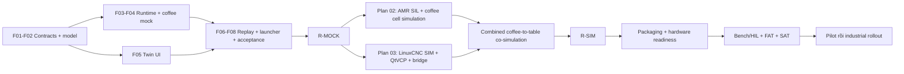

# MEKONIQ Lab Digital Twin v2 — Implementation Plan

> **For agentic workers:** REQUIRED SUB-SKILL: Use superpowers:subagent-driven-development (recommended) or superpowers:executing-plans to implement this plan task-by-task. Steps use checkbox (`- [ ]`) syntax for tracking.

**Goal:** Lab chạy mock food delivery + coffee ngay sau cài đặt, hoàn thiện simulation bằng backend thật, và có đường hardware được kiểm chứng theo từng gate.

**Architecture:** Lab là presentation/twin; source giữ business authority, journal, contracts và orchestration. AMR dùng adapter riêng; coffee/arm có device services, LinuxCNC và local controller độc lập. Mọi kết quả gắn mode/model/runtime/evidence.

**Tech Stack:** Node 24, pnpm 10.32.1, TypeScript/Vite/Three hiện có; source SQLite/domain; Gazebo/Nav2 trên Linux; LinuxCNC/QtVCP/Python cho arm; EtherCAT chỉ ở hardware profile đủ điều kiện.

**Spec:** [Spec tổng](../../specs/2026-11-05-digital-twin/README.md), [contracts](../../specs/2026-11-05-digital-twin/architecture-contracts.md), [verification](../../specs/2026-11-05-digital-twin/verification.md).

## Global Constraints

- Platform/domain/contracts/adapters đặt trong `source/`; trải nghiệm, project editor/viewer đặt trong `lab/`.
- Không sửa `trial/`, không chạm robot đang chạy hoặc cổng `1880`/`1884`; dev UI/runtime vẫn `4175`/`4176`.
- Mỗi run khóa mode, backend versions, model/world/recipe revision và seed.
- UI Việt/Nhật/Anh, giữ nhận diện navy/lime.
- Không nâng simulated evidence thành hardware qualification; không sửa production admission để mở SIL.
- Đây là plan chưa thực thi. Tên file/API/script mới là deliverable tương lai; checkbox chỉ đánh sau khi có evidence.

## 1. Thứ tự bàn giao

Mock hoàn thành sớm để Product và khách hàng review trải nghiệm; Gazebo và LinuxCNC tiếp tục song song sau khi contracts ổn định. Chỉ tuyên bố R-SIM khi **cả hai backend đã chạy** và hành trình coffee-to-table tích hợp đạt. Mock hoặc một video animation không thay thế gate này.

## 2. Các plan có thể giao độc lập

| Workstream | Plan | Bắt đầu / đầu ra |
|---|---|---|
| Nền + mock chạy ngay | [01-foundation-mock](01-foundation-mock.md) | Từ baseline hiện tại → R-MOCK, source coffee domain, twin UI |
| Food và coffee simulation | [02-simulation](02-simulation.md) | Sau F01–F04 → Gazebo/Nav2, station I/O, geometry/collision, end-to-end SIL |
| Arm + hardware | [03-arm-hardware](03-arm-hardware.md) | Sau F01/F04 → LinuxCNC SIM, QtVCP, bridge; packaging/HIL/FAT/SAT sau đó |

Công việc code của source phải ở checkout/branch sạch riêng khi bắt đầu vì working tree hiện có thay đổi của người dùng. Không export dirty source. Lab/source là Git repository riêng; commit và CI riêng, nối bằng manifest artifact hash. Không cần đổi code hoặc tạo commit source trong đợt viết bộ spec này.

## 3. Gate và evidence

Tên gate canonical và scenario assertions nằm trong [verification](../../specs/2026-11-05-digital-twin/verification.md); bảng dưới là tiêu chí phát hành tổng quát.

| Release | Điều kiện promote | Khi thiếu môi trường |
|---|---|---|
| R-MOCK | Fresh install + single launcher, food + coffee source journal, seed reproducibility, fault/replay/compare, 2D/3D UX | Block launcher/feature tương ứng; không skip rồi PASS |
| R-SIM | Gazebo/Nav2 chạy thực, LinuxCNC SIM chạy thực, coffee I/O, collision observations, coordinated transfer, evidence suite đủ | `blocked_external` cho backend cần Linux; chưa R-SIM |
| R-READY | Adapter boundaries, signed/versioned packages, capability discovery, shadow, commissioning templates, native command denial tests | Có thể đạt phần software_ready; bench/cell/venue chưa đạt |
| R-PILOT | Máy và venue cụ thể có calibration, physical tests, FAT/SAT và local authority accepted | Khóa hardware/live; không dùng sim pass để bỏ qua |
| R-INDUSTRIAL | Pilot evidence, controlled update/rollback, support/traceability, production/market qualification | Không công bố general production-ready |

Evidence thư mục mới `lab/docs/implementation/evidence/digital-twin-v2/` khi thực thi. Mỗi report có task ID, source/lab/controller revisions, host/kernel/dependencies, actual command, timestamp, result và artifact checksums. Không copy PASS từ plan. Raw logs dùng synthetic data hoặc scrubbed diagnostics, không credentials/customer data.

## 4. Ước lượng nguồn lực để lập lịch

Đây là ước lượng engineering effort sau khảo sát code, không phải cam kết ngày hoặc chi phí mua máy. Một engineer-week là 5 ngày tập trung; review/integration đã tính sơ bộ, procurement và chứng nhận bên ngoài chưa tính.

| Gói | Effort dự kiến | Nhân sự chính | Rủi ro làm tăng effort |
|---|---:|---|---|
| F01–F08, R-MOCK | 8–12 engineer-weeks | 1 platform + 1 frontend/3D; QA/Product hỗ trợ | Migration, coffee recovery/resource state |
| Plan 02 simulation | 7–11 engineer-weeks | 1 robotics + 1 platform part-time | Nav2/world compiler, simulator reproducibility |
| Arm SIM của plan 03 | 5–8 engineer-weeks | 1 controls + UI/integration part-time | DH/units, Linux environment, controller arbitration |
| Co-simulation và hardening R-SIM | 3–5 engineer-weeks | Robotics + controls + QA | Clock barriers, handoff failure/recovery |
| Software R-READY / packaging | 4–6 engineer-weeks | Controls + DevOps + security/QA | IPC/protocol matrix, update/rollback |
| Bench → cell → venue | Lập dự toán sau BOM + risk assessment | Cơ khí/điện/controls/safety/food ops | Thiết bị chưa chọn, physical validation |

Đội đủ 4 chuyên môn có thể chồng lấp giai đoạn simulation sau mock; không lấy tổng effort chia đầu người để hứa thời gian cố định. Kết thúc F02 và first LinuxCNC/Gazebo smoke cần re-estimate bằng thực tế. Demo kinh doanh khả dụng ở R-MOCK; industrial rollout không nên đặt deadline trước khi chọn máy pha, robot, drive và IPC.

## 5. Điều kiện execution chung

- [ ] Chụp baseline commit/status và phiên bản toolchain; lưu baseline test report trước khi thay code.
- [ ] Bắt đầu F01, giữ các contract changes trong source và publish artifact mới sau clean tests.
- [ ] Mỗi task chạy red test cho hành vi cần thêm, implement, green checks và review diff; không thêm test chỉ mirror UI markup.
- [ ] Mỗi PR mô tả before/after, requirement IDs, tests/limitations; UI kèm screenshot desktop/mobile VI/JA/EN.
- [ ] Sau mỗi release gate, ghi trạng thái implemented/tested/accepted riêng và các blocker; review ngân sách/lịch tiếp theo.
- [ ] Native/HW chỉ thực thi sau profile và môi trường được provision; không có bước tự tìm robot trên LAN hoặc tự chuyển từ trial.

## 6. Truy vết yêu cầu → workstream

| Nhóm spec | Deliverable chịu trách nhiệm |
|---|---|
| CORE-01, CORE-12 | F07 launcher/artifact + plan 03 installer |
| CORE-02, CORE-03 | F01/F02 contracts/migration + F03 preflight/backend registry |
| CORE-04, CORE-07, CORE-08 | F03 deterministic runtime/authority + F04 side effects |
| CORE-05, CORE-06, DT-01..05 | F02 geometry + F05/F06 live twin/residuals; plan 02/03 native telemetry/calibration và held-out shadow validation |
| CORE-09, BV requirements | F04 coffee source domain/mock; plan 02 physical model, plan 03 H00 vendor adapters/conformance và HIL interlocks |
| CORE-10, UX/QA requirements | F05/F06/F08 UI, replay/compare, acceptance |
| CORE-11, HW requirements | F01 mode boundary + plan 03 native authority, provisioning, FAT/SAT |
| FD requirements, SIM requirements | F03/F08 mock cases + plan 02 planner/physics/scenarios |
| ARM requirements | F04 mock arm representation + plan 03 LinuxCNC/QtVCP/bridge |

Spec và task-level plans là nguồn chi tiết; nếu giao một workstream cho kỹ sư khác phải gửi cả spec liên quan và schema freeze, không chỉ bảng lịch này.
