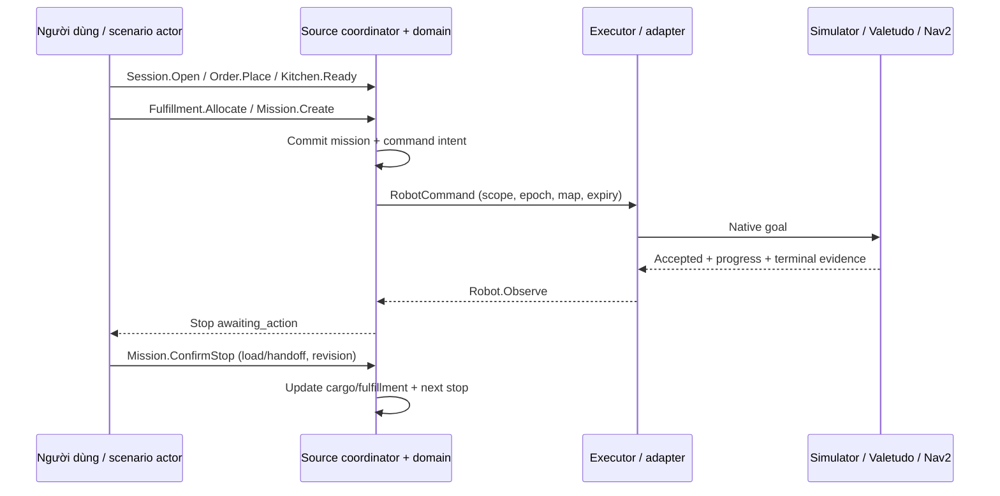
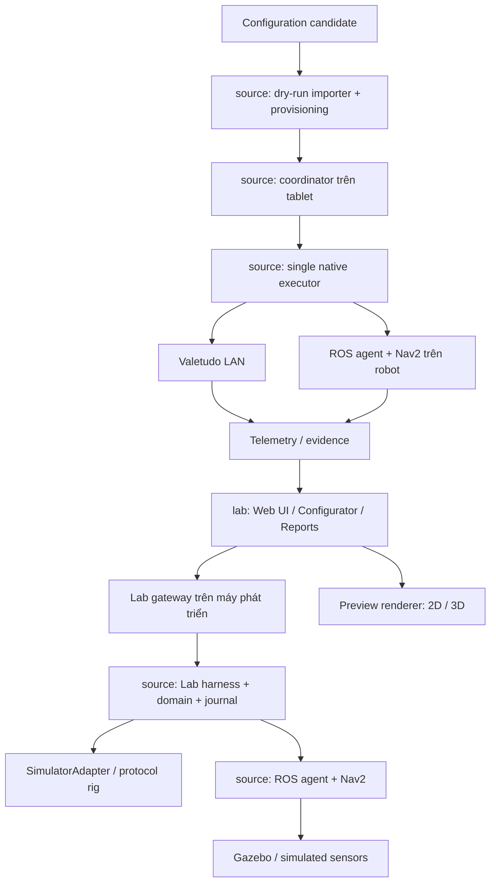

# MEKONIQ Robot Lab — Product & System Spec

Ngày: 2026-11-01 · Phiên bản: 0.1 · Trạng thái: đề xuất để review, chưa triển khai.

Đọc cùng [baseline](../research/2026-11-01-baseline-and-references.md), [integration contract](2026-11-01-source-integration.md) và [implementation plan](../plans/2026-11-01-mekoniq-robot-lab.md).

## 1. Mục tiêu và định nghĩa thành công

Mekoniq Robot Lab giúp một nhóm thiết kế **robot giao món và mặt bằng vận hành cùng nhau**, kiểm tra cấu hình, chạy lại các tình huống phục vụ, rồi đưa cấu hình đã kiểm chứng vào phần mềm `source` để nghiệm thu trên robot thật.

Ba người dùng chính:

| Người dùng | Công việc | Đầu ra |
|---|---|---|
| R&D/cơ điện | So sánh chassis, điện, tải, cảm biến; tìm lỗi trước khi mua/lắp | Design revision, BOM, estimate có giả định, test evidence |
| Kỹ sư phần mềm/triển khai | Dùng cùng mission trên simulator, Valetudo, Nav2; tái hiện lỗi | Scenario tái lập, run report, deployment candidate |
| Sales/chủ nhà hàng | Xem robot trong mặt bằng của mình, so sánh cấu hình | Demo, BOM sơ bộ, số liệu mô phỏng được ghi nhãn |

**Một lần đi trọn vòng:** chọn cấu hình → tạo mặt bằng → order → KDS ready → robot tới bếp → nhân viên xác nhận tải → tới bàn → xác nhận giao → về điểm chờ → báo cáo. Kết quả gắn với design/world/source revision. Đổi backend không thay business workflow.

“Có thể triển khai” yêu cầu: cùng release phần mềm, đúng contract, map binding theo từng robot, profile và payload được đo, executor đã provision, các test phù hợp đạt, và người vận hành chấp nhận tại venue. Mô phỏng thành công chỉ hoàn thành một phần các điều kiện này.

## 2. Phạm vi theo release

| Release | Có trong phạm vi | Chưa mở |
|---|---|---|
| **R0: nền Lab và demo giao món** | Một mẫu service robot tham số hóa; 2–4 khay; 3D đơn giản + 2D fallback; BOM/calculator; một mặt bằng 6 bàn; một robot; luồng giao món dùng source; save/export/replay | CAD tự do, tự tối ưu chassis, điều khiển hardware từ trang public |
| **R1: kiểm chứng tích hợp** | Editor mặt bằng; fault scenarios; protocol rig Valetudo; ROS/Nav2/Gazebo; so sánh run; tối đa 2 robot trong kịch bản tranh lối | Fleet diện rộng, cloud simulation farm, học tăng cường |
| **R2: commissioning/pilot** | Import cấu hình vào source staging; Android thật; robot Valetudo và chassis ROS đã chọn; shadow; controlled trial; evidence/rollback | Tự nâng trạng thái nghiệm thu; auto cutover từ trial |
| **R3: beverage research** | Cell pha chế cố định, cup/recipe/dispense state, giao đồ uống ra robot | Tự gọi navigation API để điều khiển bơm/cánh tay |
| **R4: cooking research** | Một công đoạn định lượng/gia nhiệt cụ thể, state và quan sát nhiệt/thời gian | Robot nấu mọi món, chứng nhận vệ sinh/an toàn bằng mô phỏng |

R0 không đợi phần cứng W06. R1 robotics tiếp nối W06, không chờ 3D đẹp hoặc catalog linh kiện lớn. R2 chỉ có khi các gate thiết bị của `source` và gate robot tương ứng đạt. R3/R4 cần spec riêng trước implementation.

## 3. Quy trình lấy cảm hứng từ Drone Lab

Mượn cách dẫn dắt thao tác của [Drone Lab](https://drone-engineer.vercel.app/), chuyển thành tác vụ robot nhà hàng:

| Ý tưởng trải nghiệm | MEKONIQ thực hiện | Mức ưu tiên |
|---|---|---|
| Chọn mẫu | Service robot; beverage/cooking hiển thị hướng nghiên cứu | R0 |
| Lắp ráp/tháo rời | Chassis → bánh/driver → pin/nguồn → compute/cảm biến → cột/khay → tablet | R0, asset đơn giản |
| Wiring | Phân lớp power, data, đường dừng; click xem linh kiện và giới hạn | R0 sơ đồ chức năng |
| Configurator | Đổi chassis profile, pin, sensor set, số tầng/độ cao khay | R0 catalog nhỏ |
| Calculator/BOM | Tải dự kiến, runtime, khoảng trống quay, điện, chi phí | R0 |
| Preflight | Kiểm tương thích, readiness, map và nhiệm vụ | R0/R1 |
| Simulator | Giao món, người cắt ngang, bàn bị chắn, lỗi mạng, dừng | R0/R1 |
| Học và kiểm chứng | Giải thích “vì sao bị chặn”, liên kết phép đo cần có | R0 ngắn, không xây LMS |

Không lấy màu giấy/bản vẽ tay của Drone Lab. Không chuyển các khái niệm thrust/flight time thành tải robot bằng đổi nhãn. Asset và mô tả do MEKONIQ tạo.

## 4. Thiết kế giao diện giữ nhận diện hiện tại

### 4.1. Token bắt buộc

Trích từ `lab/index.html`; giữ nguyên khi triển khai shell:

```css
:root {
  --bg: #0b151a;
  --panel: #121f26;
  --raised: #182a33;
  --ink: #edf5f3;
  --muted: #a2b8bf;
  --line: #2c424b;
  --accent: #b4f375;
  --accent-ink: #122207;
  --blue: #9dccff;
  --amber: #ffd08c;
  --danger: #ffaaa0;
  --shadow: 0 24px 80px #0003;
  --radius: 22px;
  --font: Inter,"Hiragino Kaku Gothic ProN","Noto Sans JP",-apple-system,BlinkMacSystemFont,"Segoe UI",sans-serif;
  --mono: "SFMono-Regular",Consolas,"Liberation Mono",monospace;
}
```

Giữ logo ba thanh, nền chấm kỹ thuật, card bo góc/viền mảnh, primary lime, chữ số mono, icon SVG, khoảng trắng rộng. H1 của Lab nhỏ hơn hero presentation để ưu tiên vùng thao tác; không thay font bằng font mới từ CDN. Ba ngôn ngữ Việt/Nhật/Anh theo `tr(vi, ja, en)`, Việt mặc định như `lab/index.html`; mã thiết bị/đơn vị không dịch.

### 4.2. Cấu trúc màn hình

```text
MEKONIQ | Robot Lab      Project / Revision     Demo · Business SIM     VI JA EN
──────────────────────────────────────────────────────────────────────────────
 Thiết kế            Robot 3D / mặt bằng nhà hàng                Inspector
 Mặt bằng            Orbit · 2D/3D · Layers · Fit                Linh kiện
 Kịch bản                                                      Khả năng
 Kết quả             Selected robot / target / route             BOM/estimate
 Triển khai                                                     Readiness
──────────────────────────────────────────────────────────────────────────────
 Kịch bản · Play/Pause/Step · 1×/2×/5×         Timeline / sự kiện / cảnh báo
```

- **Thiết kế:** chọn preset, exploded view slider, click linh kiện làm nổi item BOM/wiring tương ứng; undo/redo; invalid selection hiện nguyên nhân và giữ bản trước để so sánh.
- **Mặt bằng:** sơ đồ theo mét; thêm bàn/bếp/quầy/parking/dock, tường, ghế, vùng không đi; điểm handoff ở cạnh bàn, không đặt robot vào tâm bàn.
- **Kịch bản:** chọn một ca phục vụ, xem các bước; thao tác bếp/load/handoff có thể do người dùng hoặc actor script được ghi rõ `scripted`.
- **Kết quả:** outcome, evidence level, nguồn telemetry, run revision; so sánh hai run cùng metric definitions.
- **Triển khai:** các điều kiện còn thiếu, preview diff của gói cấu hình, export candidate; chỉ hiện hành động tương ứng quyền/môi trường.
- Góc trên luôn hiện loại runtime và trạng thái kết nối. “Business SIM”, “Gazebo”, “Shadow”, “Hardware test”, “Replay” khác nhau bằng nhãn + icon, không chỉ màu.
- Demo và Engineering là hai mức độ hiển thị; không biến permission thành một switch trình bày. Người xem public không thấy control phần cứng.

Desktop ≥1280px có 3 vùng; 768–1279px inspector dạng drawer; <768px chuyển tab và 2D mặc định, vẫn sửa tọa độ bằng form. Không cần drag để hoàn thành tác vụ: có chọn + nhập tọa độ, danh sách đối tượng và nút di chuyển. Mục tiêu touch 44×44px, focus hiển thị, hỗ trợ reduced motion, tương phản chữ thường ≥4.5:1. Log không chiếm focus, thông báo lỗi không dựa riêng vào màu. Mất WebGL vẫn cấu hình/export/chạy 2D được.

### 4.3. Bảo toàn HTML

Trong đợt spec này giữ nguyên `index.html`. Khi làm shell R0: lưu nguyên bản thành `business-plan.html`, đưa nội dung chỉnh sửa của Lab vào `src/`, sinh site qua build; thêm đường dẫn “Kế hoạch kinh doanh”. Không duy trì ứng dụng Lab bằng cách sửa chuỗi JS trong HTML minified. Screenshot baseline được chụp trước migration; test so sánh token và 3 ngôn ngữ, không ép UI mới giống bố cục slide.

## 5. Configurator, BOM và performance

### 5.1. Data model

Mọi artifact có `schemaVersion`, `id`, `revision`, `createdAt`, `contentHash`. Catalog item dùng ID/revision ổn định; thay catalog không tự thay thiết kế đã lưu.

| Artifact | Nội dung bắt buộc |
|---|---|
| `ComponentSpec` | Loại, khối lượng kg, kích thước m, điện áp min/max, continuous/peak current kèm duration nếu có, connector/protocol, nguồn số liệu, mức tin cậy; giá có thể thiếu |
| `RobotDesign` | Danh sách component revision/quantity, placement, chassis/drive type, tray geometry/load intent, sensor poses; label illustrative/supplier/measured trên từng tham số |
| `RobotProfileCandidate` | Footprint, wheel radius/separation, collision envelope, payload intent, sensor transforms, speed/accel request, adapter capability intent; chưa là RobotManifest đã nghiệm thu |
| `CostEstimate` | Currency, giá integer minor units dạng chuỗi, quantity, nguồn/ngày giá, FX do người dùng nhập nếu trộn tiền, công thức margin/markup |
| `PerformanceEstimate` | Model version, inputs/units, assumptions, output range, missing inputs; không chứa `hardware_validated` |

Chassis preset đầu: `service-differential-illustrative` (tự dựng hình học, chưa gắn vendor); `valetudo-reference` là hộp đen về drivetrain, chỉ cấu hình phần giá/khay và giới hạn đã xác minh. S100/ZLTECH là candidate theo W06, không điền pinout/SDK/tải khi chưa có tài liệu nhà cung cấp.

Linh kiện không tương thích bị chặn trước export candidate: điện áp không giao nhau, payload vượt thông số đã biết, xung đột connector, không đủ input cảm biến, LiDAR bị khay che, thiếu dữ liệu kích thước để xác định footprint. Giá thiếu = “chưa có giá”, tổng ghi “partial”; không biến missing thành 0. Có thể lưu thiết kế chưa hoàn chỉnh với reasons, nhưng không đạt readiness.

### 5.2. Công thức có giới hạn rõ ràng

Các công thức sau là mô hình kỹ thuật sơ bộ do Lab đề xuất, không phải chứng nhận cơ điện. UI hiện đầu vào và đơn vị; chỉ tính khi có đủ dữ liệu, không tự khẳng định tải an toàn.

| Chỉ số | Công thức / quy tắc |
|---|---|
| Khối lượng | `m_total = Σ(q_i × m_i) + payload_kg` |
| Năng lượng khả dụng | `E_Wh = V_nom × Ah × usable_fraction × battery_derating` |
| Công suất ca | `P_avg = duty_move × P_move + duty_idle × P_idle + duty_task × P_task`; duty cộng bằng 1; công suất đo tại pin, không nhân efficiency lần hai |
| Runtime | `t_hours = E_Wh / P_avg`; đưa low/high từ các tổ hợp công suất/derating, không báo đến nhiều chữ số thập phân |
| Mô-men sơ bộ | `F = m_total × a + Crr × m_total × g × cos(slope) + m_total × g × sin(slope)`; `τ_wheel = F × r / n_driven`; motor shaft chia thêm gear ratio × gear efficiency; thiếu continuous torque thì không PASS |
| Differential drive | `v=(v_R+v_L)/2`, `ω=(v_R−v_L)/track`; quay tại chỗ có tâm quay bán kính 0 nhưng swept envelope vẫn bằng vùng footprint quay |
| Khoảng dừng sơ bộ | `d = v × reaction_latency + v²/(2 × decel)` với `decel > 0`; dùng để lập test, không tự chọn tốc độ khai thác |
| Trọng tâm | `CoM = Σ(m_i × p_i)/Σm_i`; kiểm hình chiếu nằm trong support polygon với margin cấu hình; không thay test chống lật/trượt khi mang chất lỏng |
| Giá | Parts + assembly + QA + logistics + warranty allowance; sell-before-tax `cost/(1−gross_margin)` với `0≤margin<1`; markup là phép tính riêng, không lẫn margin |

Money dùng integer/decimal chính xác; VND minor unit là đồng. Chưa có rate thì không cộng VND và USD. Thuế, giá thuê và doanh thu không được suy ra từ BOM. Estimate ghi ngày và phạm vi loại trừ như tablet/dock nếu chúng chưa nằm trong lựa chọn.

Ví dụ test tổng hợp: pin 24V×20Ah, usable 0.8, derating 0.9, P_avg 120W → 345.6Wh và 2.88h. Đây là fixture toán, không phải cấu hình đề xuất mua.

### 5.3. Wiring và assemble

Sơ đồ chức năng tách: pin/BMS/cầu chì/nguồn → driver/motor; DC-DC → compute/sensors; encoder/LiDAR/IMU → MCU/ROS; đường E-stop/watchdog tới bộ điều khiển phù hợp. Đây là sơ đồ quan hệ, chưa là wiring thi công. Pin-level drawing chỉ mở khi có source tài liệu, revision, polarity và review kỹ thuật tương ứng.

Animation lắp ráp không bật nguồn. “Kiểm tra” trong demo tạo report ảo có nhãn; không được tạo biên bản hardware. Các ràng buộc cơ khí/điện chưa kiểm chỉ hiện pending. Kiến thức giải thích tại component, không bắt người dùng làm quiz để chạy demo.

## 6. Nhà hàng và runtime mô phỏng

### 6.1. World model và map

`RestaurantWorld` dùng SI, frame world x/y hướng phải/lên, z lên, yaw radian; chứa bounds, walls/polygons, furniture, station/table semantic IDs, waypoints, parking, dock, corridor zones, moving actors và spawn poses. Layout business ID của `source` là reference; hình học không nhét vào API layout hiện tại chưa hỗ trợ nó.

Một template 12×8m, 6 bàn, 1 bếp, 1 điểm chờ, 1 dock tùy chọn; một lối hẹp có thể điều chỉnh. Số đo là fixture. World compiler xuất JSON cho renderer và SDF/map assets cho Gazebo từ cùng revision. Map occupancy, origin, resolution và thresholds được ghi rõ; visual mesh và collision mesh có cùng scale. Bàn moved tạo world revision mới và vô hiệu hóa kết quả/binding bị ảnh hưởng.

Ảnh sơ đồ thật là lớp nền cần hiệu chuẩn scale; không tự là occupancy map. Kéo bàn trong Lab không cập nhật map SLAM trên robot. Binding giữ `waypointId → robot mapId/mapRevision/frame/target`, theo từng robot. Valetudo/native map khác không chia sẻ tọa độ vì trông giống nhau.

### 6.2. Các mức thực thi

| Mode | Bộ thực thi | Kết quả chứng minh được |
|---|---|---|
| `preview` | Renderer/kinematic animation trong browser | Trải nghiệm, hình học minh họa, calculator |
| `business_sim` | Source domain + durable journal + SimulatorAdapter trong local Lab harness | Mission, allocation, handoff, idempotency, continuity ở mức phần mềm |
| `protocol_sim` | Adapter production + server giả lập REST/MQTT/native faults | Hợp đồng wire, retry/reconcile và adapter; không phải robot thật |
| `gazebo_sil` | Source Python agent + Nav2 + Gazebo, source coordinator/harness | Navigation trên model physics/sensors và nghiệp vụ |
| `shadow` | Quan sát telemetry thật, không có quyền mutation | Độ đúng mapping/telemetry; không chứng minh chuyển động mới |
| `hardware_test` | Android/ROS executor thực đã provision; source UI phát lệnh | Tính đúng trên thiết bị cụ thể, theo test đã chạy |
| `replay` | Đọc record bất biến | Debug/trình bày lại, không phát lại physical effect |

Trong business_sim, hình robot di chuyển có thể là nội suy để người dùng nhìn được; chỉ event của adapter qua domain mới thay đổi mission. Cảnh báo vật cản trên canvas không được gọi là Nav2 avoidance. Trong Gazebo, UI render pose quan sát; physics và action server quyết định chuyển động. Không dùng `requestAnimationFrame` làm đồng hồ điều khiển hay tự nhận arrival.

Preview không có gate kỹ thuật. Business SIM dùng fake clock thống nhất giữa command expiry, domain và simulator. Gazebo dùng `/clock` cho navigation; harness phải map thời gian kịch bản một cách tường minh. Hardware dùng thời gian thực; không có tua nhanh, reset world hay pause physics.

### 6.3. Workflow đầu tiên



Hành trình business gốc chỉ hoàn thành load/handoff theo stops được tạo. Bước về parking là mission standby tiếp theo do cùng source command path tạo, không tự nối thêm một trạng thái không tồn tại. Parking khác charging: không có docking capability/evidence thì không hiển thị “đang sạc”.

## 7. Scenario và báo cáo

Scenario là dữ liệu có version/seed, initial world/design, actor actions, fault schedule, assertions và timeout. Không nhận JS/Python/shell tùy ý trong file import. Randomness dùng seed; ghi wall/sim time riêng. Tái lập chính xác mong đợi ở business_sim; Gazebo so theo invariant/tolerance, không hứa trajectory bit-for-bit giống nhau.

| ID | Tình huống | Điều phải chứng minh |
|---|---|---|
| S01 | Bếp → 1 bàn → parking | Không giao trước load/handoff; command/stop trace đầy đủ |
| S02 | Giao nhiều bàn, khay khác nhau | Không trộn allocation; xác nhận một bàn không giao các bàn còn lại |
| S03 | Người cắt ngang | Gazebo dừng/chờ/đi lại theo sensor; không xuyên vật cản |
| S04 | Ghế chắn đích/lối bị đóng | Không false arrival; giữ pending hoặc needs_attention |
| S05 | Pin thấp/tải vượt/thiếu capability | Admission từ chối có lý do; không có native goal |
| S06 | Mất WAN, còn LAN | Source vẫn phối hợp trong quyền được cấp; sync lại không di chuyển lần hai |
| S07 | Mất LAN/coordinator partition | Không tự đổi owner; không phát command mới từ peer mất quyền |
| S08 | Crash sau native accept, trước receipt | Một native start hoặc unknown; không resend mù |
| S09 | Map revision thay đổi/pose stale/localization lost | Chặn dispatch hoặc attention; không dùng vị trí cũ chứng minh tới |
| S10 | Cancel/retarget lúc có hàng | Stop/cancel có evidence; hàng được trả/unload; không ghi đã giao |
| S11 | STOP, E-stop, reset | ACK phần mềm khác physical stop; reset vật lý không tự resume mission |
| S12 | Duplicate/reordered/retained telemetry | Không đảo terminal state, không tạo completion từ snapshot cũ |
| S13 | 2 robot dùng lối hẹp | Admission serialize vùng xung đột; unknown không giải phóng reservation chỉ vì TTL |
| S14 | Import/replay report | Không có robot.execute, thu tiền hoặc in; lịch sử chỉ để xem |

Metrics: tỷ lệ mission hoàn thành / mission bắt đầu (kèm nhóm lỗi), thời gian ready→handoff, travel và human wait riêng, p50/p95, số lần can thiệp, distance từ pose đủ mẫu, fault recovery, collision/contact, late/unknown events. Mỗi metric có đơn vị, sample count, window, engine; thiếu mẫu distance thì `unavailable`, không nội suy số liệu marketing. Pin/năng lượng mô phỏng không là phép đo pin thật.

Report có run ID; design/world/scenario/source/adapter hash; seed; mode; clock; raw event/log refs; expected/actual assertions; pass/fail/blocked/not_run; hardware identity nếu có. KPI giả định, estimate và số đo không chung cột không nhãn. Thay bất kỳ input liên quan làm report cũ thành “khác cấu hình hiện tại”, không xóa lịch sử.

## 8. Kiến trúc và công nghệ



- Lab web: TypeScript strict, Vite, HTML/CSS module theo hướng tablet source; Three.js chỉ là renderer 3D lazy load, SVG/Canvas cho 2D/wiring. Không thêm Next.js backend thứ hai cho Lab.
- Gateway/harness chạy trên máy phát triển; Node.js 24 và pnpm 10 cùng baseline source. Có thể dùng Ubuntu host/VM cho robotics; Mac chạy web và nối Linux simulation, không yêu cầu robot runtime native macOS.
- ROS 2 Jazzy / Ubuntu 24.04 / Gazebo Harmonic giữ theo W06 và [pairing chính thức](https://gazebosim.org/docs/jetty/ros_installation/). Container/image dùng digest sau khi build test; không dùng tag `latest` làm evidence.
- `source` giữ business logic, schemas, robot runtime và simulation assets có giá trị production. `lab` giữ UI, scenario và robot design presentation. Bộ package/artifact được xuất có checksum và lock file; không import xuyên repository bằng đường dẫn browser.
- R0 project lưu IndexedDB, export/import JSON; reset yêu cầu chọn đúng project. Run evidence nặng lưu local artifact directory ngoài Git. Cloud collaboration không thuộc R0.
- Tại nhà hàng vẫn cloud + tablet coordinator + compute trên robot; Lab gateway/Gazebo không là máy chủ bắt buộc mới ở venue.

## 9. Invariants và runtime boundary

1. Một robot chỉ có một native command owner/executor trong mỗi control epoch.
2. `accepted`, `arrived`, `handoff`, `mission completed`, `charged` là bằng chứng khác nhau.
3. Mất ACK không tương đương lệnh chưa chạy. Unknown khóa dispatch tương ứng cho tới reconcile có chứng cứ.
4. Runtime native không fallback simulator. Không quảng bá simulated thành hardware_validated từ dropdown hoặc JSON import.
5. Replay/historical import không thực thi robot/payment/print effects.
6. Cloud/browser không trực tiếp gọi ROS action, MQTT goto hoặc motor driver.
7. Map/geometry/design/firmware thay đổi phải invalidation đúng phạm vi; không coi “cùng kích thước ảnh” là cùng map.
8. UI Pause chỉ dừng mô phỏng hoặc dừng hiển thị theo mode. Trong hardware, dùng yêu cầu dừng qua source, không gọi Pause là E-stop.
9. Đường E-stop/watchdog vật lý độc lập với browser/cloud. [Nav2 Collision Monitor](https://docs.nav2.org/jazzy/configuration_and_development/configuration_guide/core_servers/collision_monitor/configuring_collision_monitor_node/) không tự cung cấp chứng nhận an toàn phần cứng.
10. URL/model/plugin/upload trong artifact không được biến thành remote code hoặc endpoint điều khiển tùy ý.

Public build chỉ preview/replay dữ liệu đã khử nhạy cảm. Gateway loopback, pairing token, kiểm Origin/Host và session, CSRF cho mutation, allowlist backend được provision; không wildcard CORS, không arbitrary proxy tới LAN. Report không chứa credential, private key hay địa chỉ robot thật mặc định.

## 10. Gate nghiệm thu và hiệu năng

| Gate Lab | Đầu vào/điều kiện | Đầu ra |
|---|---|---|
| G0 — cấu hình/demo | Token, 3 locale; invalid catalog bị chặn; BOM toán đúng; save/export roundtrip; no-WebGL fallback | Bản web review được; không ghi robotics PASS |
| G1 — business | S01/S02/S05–S10/S12/S14 ở mức phần mềm; source journal thật; schema tương thích | Report business_sim với evidence local |
| G2 — protocol + SIL | Valetudo conformance; S01/S03/S04/S09/S11 trong Gazebo; S08 crash process; S13 nếu bật 2 robot | Report protocol và Gazebo riêng; thiếu backend ghi blocked_external |
| G3 — hardware | Device native executor, model/firmware, map, tải/tốc độ đã đo; STOP/watchdog, network/reboot, hành trình có người giám sát | `hardware_validated` cho đúng tuple thiết bị/config |
| G4 — venue | Gate A/source continuity và Gate B/source pilot, đào tạo, nghiệm thu mặt bằng, rollback sẵn | `venue_approved` đúng venue; không tự là W11 release |

Ngưỡng đề xuất cho G1: 20 seed cố định/run fixture, 0 invariant vi phạm, 0 native effect duplicate. G2: ít nhất 10 lượt của mỗi scenario navigation trên image/model pin, 0 false completion, 0 collision trong các lượt này; báo success count chứ không suy rộng xác suất an toàn. G3/G4: tối thiểu 20 chu trình tại payload/tốc độ giới hạn được nghiệm thu và mọi fault test bắt buộc; đây là cỡ mẫu acceptance đề xuất, không là chứng nhận. Dừng lỗi nghiêm trọng để sửa và tạo evidence mới.

Các tolerance pose, tốc độ/dừng và payload hardware phải lấy từ profile measured; không gán giá demo thành threshold nghiệm thu. Thiếu hardware thông số được ghi `blocked_external`, không dừng các công việc simulation độc lập.

Mục tiêu UX cần đo khi build: first usable ≤3s với bundle cache lạnh trên laptop Chrome tham chiếu được ghi trong report; editor 100 objects không block input >100ms p95; 3D ≥30fps cho 1 robot/scene mặc định; UI coalesce pose 10Hz, giữ event đầy đủ. Không dùng mục tiêu này để khẳng định đã đo. Telemetry stale threshold theo profile, default demo 2s; chữ “live” phải có timestamp và stale state.

## 11. Mở rộng pha chế và nấu ăn

Reuse được: catalog/BOM, 3D, recipe/scenario editor primitives, journal/identity, report, capability + versioning, allocation/handoff. Không ép thao tác bơm/gia nhiệt/cánh tay vào `RobotCommand` điều hướng v1.

**Beverage:** một cell cố định là R&D đầu tiên; lệnh nghiệp vụ “pha một cốc theo recipe revision”, không gửi raw motor. Workflow reserve nguyên liệu/cốc → cup present → dispense → kiểm lượng → ready → xác nhận pickup → delivery. Recipe giữ đơn vị chính xác, allergen/cleaning context và batch provenance. Mất ACK giữa dispense phải giữ unknown và cân/kiểm thực tế; không tự pha lại. Cánh tay là adapter riêng nếu cần, không phải điều kiện mở đầu.

**Cooking:** bắt đầu một công đoạn như định lượng + gia nhiệt có cảm biến; workflow recipe step → sensor/interlock check → execute → verify → hold/handoff. Có time/temperature trace, over-temperature/door/empty vessel interlock và nguồn cắt độc lập; policy khi mất điện không tự resume gia nhiệt. Các yêu cầu vệ sinh/thực phẩm và cơ điện được xác định theo thiết bị/thị trường ở spec riêng; chưa tuyên bố tuân thủ chuẩn cụ thể.

Điều kiện mở R3: R2 có bằng chứng sử dụng thực địa, chọn được một loại đồ uống/cell và owner phần cứng. Mở R4 sau khi cell xử lý ingredient trace/cleaning/recovery ổn định. Tab R3/R4 hiện “Nghiên cứu”, không có nút giả vờ deploy.

## 12. Quyết định cần dữ liệu khi triển khai

| Quyết định | Mặc định dùng để bắt đầu | Khi nào cần dữ liệu thật |
|---|---|---|
| Chassis đầu tiên | Generic differential illustrative + Valetudo contract reference | Trước G3: model, firmware, geometry, driver, payload và sơ đồ điện |
| Catalog/giá | Fixture có nhãn, giá thiếu giữ unknown | Trước báo giá: supplier/date/currency và chi phí thực |
| Venue | Template 12×8m/6 bàn | Trước map binding thật: survey, map identity, điểm dừng đo tại chỗ |
| Nguồn W06 | Contract hiện có + task W06 đã phân owner | Trước integrate: revision API/schema và evidence task thực tế |
| GPU simulation | Ubuntu workstation/VM, headless nếu phù hợp | G2: xác nhận image/architecture/real-time factor thực chạy |

Không có câu hỏi nào ở bảng này ngăn viết spec, xây shell hoặc chạy business_sim. Chúng là điều kiện để tạo evidence tương ứng ở mức sâu hơn.
