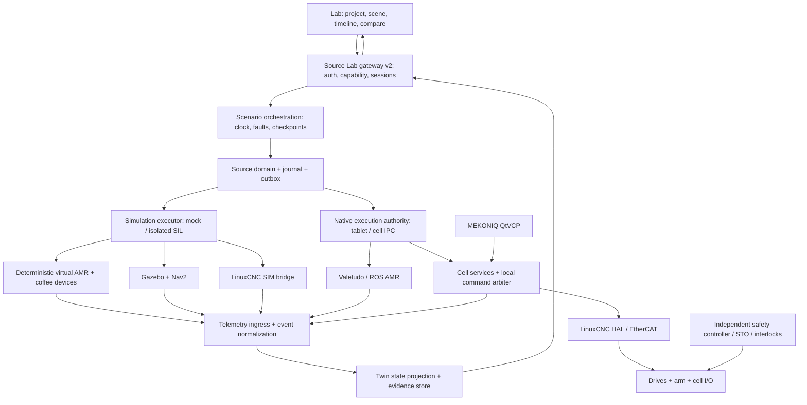

# Kiến trúc và contracts — Lab Digital Twin v2

Trạng thái: đề xuất, 2026-11-05. Đọc [phạm vi](README.md), [simulation](simulation.md) và [plan nền](../../plans/2026-11-05-digital-twin/01-foundation-mock.md). Các tên v2 dưới đây là API cần xây dựng, không là API đã tồn tại.

## 1. Trách nhiệm và luồng dữ liệu



`source` là authority cho order/recipe/job/resource/mission; controller là authority cho machine state. Twin projection kết hợp dữ liệu, không thay authority của chúng. Dữ liệu prediction/preview không được phát `Robot.Observe completed` hoặc hoàn thành coffee job.

| Boundary | Ownership / vị trí đề xuất | Điều không được làm |
|---|---|---|
| Lab UI | `lab/src/twin`, `src/scenarios`, `src/runtime` | Tự xử lý order, tự nhận máy đã dừng, giữ robot credentials |
| Public contracts | `source/packages/contracts` | Nới v1 để nuốt payload v2 không tương thích |
| Orchestrator và projection | `source/packages/lab-runtime/src/v2` | Chạy servo loop, làm lại business state machine |
| Domain coffee | `source/packages/domain/src/beverage` | Dùng navigation command cho brew/pump/gripper |
| Device adapters | `source/packages/cell-adapters` (mới) | Coi timeout là hoàn thành hoặc tự dispense lại |
| AMR simulation | Simulation executor và `RobotAdapter` hợp đồng hiện có | Giả `hardware_validated` để vượt admission SIL |
| Arm controller | `source/integrations/arm-controller` | Để QtVCP widget chứa toàn bộ logic nghiệp vụ |
| Native deployment | Tablet coordinator, robot agent, cell IPC | Để browser trở thành controller hoặc auto failover quyền khi mất mạng |

## 2. Mode và capability

UI có ba lựa chọn chính nhưng luôn hiện **backend cụ thể** và access level.

| Mode | Backend hợp lệ | Clock / networking | Bằng chứng |
|---|---|---|---|
| `mock` | `mock_amr`, `mock_coffee`, `mock_arm` | Virtual clock, outbound robot/device transport bị vô hiệu; chạy Node 24 Mac/Linux | Business + deterministic modeled behavior |
| `simulation` | `gazebo_nav2`, `linuxcnc_sim`, `coffee_io_sim` | Gazebo sim time; LinuxCNC controller wall time; mạng môi trường simulation riêng | Planner/controller/geometry hoặc physics theo provider |
| `hardware`, access `shadow` | Các observer đã provision | Real wall/monotonic time, read-only | Actual telemetry, không cấp quyền điều khiển |
| `hardware`, access `hil` | Bench profile được chấp nhận | Local authority + lease; subset thiết bị thật ghi rõ | HIL theo phần cứng cụ thể |
| `hardware`, access `live` | Cell/venue đã nghiệm thu | Native executor, local interlocks | Actual operational evidence theo revision |

`preview` và `replay` là **view**, không phải execution mode. Preview browser offline được phép dùng fixtures để thử UX, luôn `ui_fixture`; không tạo business report mang source execution evidence. Replay không có control transport. Không trộn mock entity vào live run để lấp feedback bị mất. HIL có thể có simulated I/O nhưng manifest phải liệt kê fidelity từng entity và không được vượt scope chứng minh.

Health trả capabilities thực tế: installed, compatible, reachable, commissioned là bốn trạng thái riêng. Backend chưa cài hiện lý do + hướng dẫn; không âm thầm chuyển simulation sang mock. Mode/backend/access bất biến trong run; đổi chúng tạo run mới sau preflight, không nối queue cũ.

## 3. Những yêu cầu nền bắt buộc

| ID | Yêu cầu / observable outcome |
|---|---|
| CORE-01 | Mock một lệnh sau install, source runtime sạch đã pin, food và coffee chạy offline không phụ thuộc robot/Linux |
| CORE-02 | v1/S01 giữ nguyên; v2 schema/API mới; migration backup, validation và unsupported export rõ ràng |
| CORE-03 | Backend registry và preflight kiểm capability; không silent fallback hoặc đổi mode giữa run |
| CORE-04 | Source authorization/journal/outbox và observer ownership được giữ; browser không được chọn actor/controlEpoch |
| CORE-05 | Mọi entity có model/frame/provenance; unknown giữ null và reason, không điền 0 thành feedback |
| CORE-06 | Telemetry freshness, epoch/sequence, reconnect gap, backpressure có test; stale không trông như live |
| CORE-07 | Seed + clock + inputs + versions tái lập mock; canonical digest bỏ UUID/keys/wall timestamps |
| CORE-08 | Command/action idempotency, expiry, receipt và unknown reconciliation; không replay side effect sau crash |
| CORE-09 | Coffee job/recipe/resources là domain trong source; physical transfer cần evidence hai phía |
| CORE-10 | Replay/compare/export chỉ đọc, metric có population/units/fidelity và dữ liệu gốc |
| CORE-11 | Hardware credentials/endpoint không nằm trong project/report/master image; local authority được kiểm phía server |
| CORE-12 | Packages/installer có pin/hash/SBOM, migration/rollback, clean-host smoke và compatibility report |
| DT-01 | AssetRevision là nguồn chung cho visual, collision, kinematics, inertia và provenance, không lấy mesh trang trí làm footprint |
| DT-02 | Twin state tách commanded/observed/estimated, freshness, uncertainty và causation |
| DT-03 | Model changes tạo revision mới; run/report bất biến, calibration drift làm evidence không còn phù hợp |
| DT-04 | Cùng entity có thể xem 2D/3D/timeline/diagnostics với cùng selection và trạng thái |
| DT-05 | Twin live/shadow đối chiếu prediction với actual và ghi residual; không tự hiệu chỉnh controller |

## 4. Canonical model

Schema authoritative nằm trong `source/packages/contracts/schemas/`; TS types được generate rồi đưa vào runtime artifact cho Lab, không duy trì một bản schema gần giống trong browser.

| Object v2 | Nội dung bắt buộc |
|---|---|
| `AssetRevision` | `id`, `revision`, `contentHash`, `kind`, visual/collision model refs, frame tree, geometry; kinematics/inertial/sensor/tool refs theo kind; provenance từng tham số |
| `WorldRevision` | Mặt bằng SI, static objects, zones, AMR handoff poses, cell base/fixtures, pedestrian actors, semantic connections; asset refs/hash |
| `RecipeRevision` | Recipe ID/hash, output/cup type, ordered steps, resource requirements, target quantities + tolerances + provenance, timeout/recovery policy |
| `DeviceProfileRevision` | Provider/capabilities/units conversion/status mapping/firmware/calibration refs; transportRef do provisioning server quản lý |
| `ScenarioRevision` | Recipe/order workload, initial state, seed, ordered scripted actions/faults, stop conditions và assertions |
| `RunManifest` | Project/world/asset/recipe/scenario hashes, source/runtime/controller/provider versions, mode/access/backends, seed, clock policy, actual device serial refs nếu được phép |
| `TwinSample` | Entity + frame + observed/commanded/estimated data, provider origin, bootId, seq, sim time, monotonic receipt time, quality, causation |
| `EvidenceRecord` | Requirement/scenario, inputs manifest, result pass/fail/blocked_external/not_run, assertions/raw artifacts, actual fidelity, signer/trust provenance |
| `DeploymentCandidate` | Revision mapping, dry-run diff, required gates/evidence refs, scope venue/machine; không có commands/secrets hay quyền execution |

`contentHash` dùng SHA-256 canonical JSON; manifest ghi thuật toán/version. Geometry tham chiếu asset trong bundle qua content hash, cấm executable URI/path traversal và không tải network URL tùy ý từ project. Asset thiếu mass/inertia chỉ chạy capability tương ứng; không phát kết quả dynamics. Vendor CAD phải có license/provenance. PUMA reference tách ID khỏi MEKONIQ physical robot.

### 4.1 Units và frames

- SI nội bộ: m, s, kg, rad, N, N·m; volume lưu m³, UI ml; temperature K, UI °C; lượng recipe/inventory dùng exact decimal string với scale khai báo, telemetry geometry dùng finite number; adapter chịu trách nhiệm đổi từ ml/°C/mm/inch/deg của thiết bị.
- Right-handed world, +Z lên; base AMR +X trước, +Y trái; quaternion `[x,y,z,w]`, normalized; UI 2D đổi screen-Y có kiểm thử round trip.
- Frame tree `world → map → base_link → sensor/tool` cho AMR; `world → cell_base → arm_base → link_1..6 → flange → tcp`; cup có attachment parent đúng một thời điểm.
- Transform `T_A_B` biến tọa độ từ B sang A. Calibration ghi parent/child, source, covariance/uncertainty nếu có, timestamp và revision. Không có transform hợp lệ thì overlay world bị unavailable, không đoán pose.
- LinuxCNC PUMA sample có thể dùng inch/deg; kiểm theo pinned INI. DH modified/Craig phải ghi convention; không chuyển sang URDF bằng cách chép số. FK golden vectors kiểm từng conversion.

### 4.2 Snapshot và telemetry

```ts
// Logical contract; source JSON Schema là bản kiểm tra wire khi triển khai.
type ExecutionMode = 'mock' | 'simulation' | 'hardware';
type Quality = 'valid' | 'stale' | 'unknown' | 'invalid';
interface TwinSample {
  schemaVersion: 2; runId: string; entityId: string;
  providerId: string; bootId: string; seq: string;
  simTimeNs: string | null; observedAt: string | null;
  receivedMonotonicNs: string; frameId: string;
  origin: 'mock' | 'controller_sim' | 'physics_sim' | 'hardware';
  quality: Quality; reasonCodes: string[];
  commanded: Record<string, unknown> | null;
  observed: Record<string, unknown> | null;
  estimated: Record<string, unknown> | null;
  causationId: string | null;
}
```

Wire schemas cụ thể cho AMR/arm/cup/coffee device thay `Record` bằng fields hữu hạn, `additionalProperties:false`. Arm gồm 6 joint commanded/actual, velocity, following error, homed/limit state, TCP; AMR gồm pose/twist/path, localization quality, battery/cargo; coffee gồm cycle state, cup presence, target/actual quantity, temperature, cleaning status; null cần reason. `receivedMonotonicNs` được stamp tại gateway; không so đồng hồ monotonic giữa host. Wall timestamp chỉ để đối chiếu người dùng, không làm ordering authority.

Gateway nhận nguồn ≥20 Hz khi provider có khả năng, publish scene 10 Hz (mục tiêu cấu hình đầu); browser interpolate để render nhưng không tự sinh feedback. Default freshness pose/joint 500 ms, device status 2 s theo gateway monotonic receipt; hardware profile có thể chặt hơn. Quá ngưỡng hiển thị stale, giữ last value kèm age; heartbeat còn sống không được refresh age cho measurement không đổi mới. Rendering interpolation bị chặn khi stale/epoch đổi. Khi mock/simulation đã nhận đủ pause ACK, hiển thị `FROZEN_SIM` cùng tuổi measurement thật; miễn alarm observation-stale trong khoảng pause đã xác nhận, nhưng heartbeat/transport vẫn dùng monotonic deadline và không refresh measurement. Hardware không có ngoại lệ pause-age này. Ngưỡng này phục vụ giám sát, không là watchdog an toàn.

## 5. API v2 và bảo vệ quyền

Prefix `/lab/v2`, độc lập `/lab/v1`. Pairing server tạo cookie riêng path v2 và CSRF, lifetime mặc định 1 giờ, token dùng một lần 5 phút như baseline. Restart invalidates browser sessions; run evidence không mất. Live authentication/roles thuộc native provisioning, không tự được cấp bởi local demo pairing.

| API đề xuất | Hành vi |
|---|---|
| `GET /health` | `protocolMajors`, versions, backend capability/reasons, scenario catalog; không trả credentials |
| `POST /sessions` | Pairing v2, server identity/principal; không nhận role tự chọn |
| `POST /projects/validate` | Kiểm schema/assets/capabilities, trả issues theo field; không apply phần cứng |
| `POST /runs` | `{project, scenarioId, scenarioRevision, seed, mode, backendSetId, access, runtimeIdentity}` → 201 snapshot/manifest; server resolve provider profiles |
| `GET /runs/:id` | Snapshot coherent + `runRevision`, `eventCursor`, `telemetryCursor`, fidelity/age |
| `POST /runs/:id/actions` | `{actionId,expectedRevision,kind,payload}`; allowlist per mode/state/role |
| `GET /runs/:id/events` | SSE durable business events; `Last-Event-ID` cursor; unavailable cursor → reset-required + snapshot |
| `GET /runs/:id/telemetry` | SSE coalesced latest samples; gaps explicit, không là audit ledger |
| `GET /runs/:id/report` | Immutable report/checksums/evidence; report incomplete nếu còn unresolved state |
| `POST /runs/:id/reclaim` | Re-pair + explicit local run ownership proof; chỉ mở lại view/reconcile, không resend queue |

Actions: `start`, `pause`, `step`, `resume`, `confirm`, `cancel`, `injectFault`, `reconcile`. Mock cho virtual step; simulation theo capability; hardware không có time travel/fault injection. `confirm` có `subjectId`, `confirmationType`, actor provenance human/scripted; server kiểm pending state. Browser không được gửi raw G-code, HAL, endpoint, actor, ROS topic, arbitrary shell hay recipe script. Chương trình được chọn bằng ID/hash từ registry đã kiểm.

`runRevision` chỉ thay khi durable business/control state thay, không tăng theo mọi telemetry tick để tránh conflict vô nghĩa. Action receipt khóa `(runId, actionId)` và canonical request digest; cùng request trả receipt cũ, khác payload → 409. Native dispatch có command ID riêng + authority epoch + expiry; deadline transport/native lease dựa monotonic clock tại executor, không tin client time. Mock business/command expiry dùng injected simulation clock; thay tốc độ render hoặc chạy 5× không thay semantics expiry. Bridge chuyển expiresAt thành deadline local khi nhận và kiểm clock skew theo profile trước admission. Unknown giữ resource/cargo, recovery bằng observe/reconcile có audit, không tự gửi lại brew/motion.

Giới hạn đầu: JSON request ≤1 MiB; project ≤200 entities và ≤200 geometry primitives, asset blobs qua package riêng tối đa 50 MiB uncompressed, cấm ZIP traversal/bomb. 10 sessions/20 runs/process; tối đa 4 run đang chạy, trong đó 1 co-simulation; 10.000 durable actions/run, duration mock ≤8 giờ sim, telemetry bounded 100 MiB/run; quota đầy kết thúc bằng reason `EVIDENCE_STORAGE_FULL`, không báo complete. Giữ business events đầy đủ trong quota. Browser giữ tối đa 60 s telemetry rồi downsample, báo số drop; không drop commands/business events âm thầm. Poll fallback 500 ms foreground/2 s background nếu SSE không khả dụng; resume lấy snapshot/cursor trước enable actions. LAN/hardware telemetry cần TLS/mTLS tại provider bridge theo deployment; gateway dev vẫn loopback.

## 6. Determinism, clocks và co-simulation

Mock có fixed step 20 ms, seeded PRNG algorithm/version khóa trong manifest, event priority `(simTime, stagePriority, entityId, sequence)`. Không dùng `Math.random()`/`Date.now()` trong model; business time inject từ clock. UUID và signing keys vẫn ngẫu nhiên cho identity/security; replay comparison chuẩn hóa chúng thành logical IDs, không hứa byte-identical journal signatures.

Mock pause đóng băng sim clock; step tiến nguyên N ticks; scripted actor actions có timestamp mô phỏng, human waits được báo riêng. Gazebo dùng sim clock; LinuxCNC SIM chạy ở controller wall time, không mặc định nhận step/seek/speed 5×. Co-simulation giữa hai engine mặc định **1× với barriers** tại cup-ready, arm-transfer-complete, AMR-docked; supervisor ghi clock skew, heartbeat và barrier timeouts. Mất provider giữ `needs_attention`, không cho engine còn lại đi tiếp một transfer. Nút Pause: gửi hold tới providers và chờ ack; chỉ hiện paused sau khi đủ ack, nếu thiếu hiển thị partial/unknown. Playback timeline khác execution control.

Mỗi entity có đúng một source authority cho trạng thái vật lý. Khi joint do LinuxCNC điều khiển, Gazebo có thể mirror joint để kiểm contact; không đồng thời chạy trajectory controller khác cho joint đó. Coffee I/O state phải có mock/sim backend, không thay bằng animation pour. Transfer cup commit khi source cùng nhận cell release và receiver accept của cùng transferId; timeout không biết cup ở đâu → quarantine, operator reconciliation.

## 7. Digital twin calibration và evidence lifecycle

Twin gồm asset thật hoặc mẫu, model có version, current state, lịch sử, prediction và evidence độ phù hợp. Trước khi có physical binding, gọi **simulation twin**. `hardware/shadow` mới nối actual entity ID/serial/calibration và ghi thời gian cập nhật. Model update không ghi đè lịch sử run.

Compare prediction/actual: residual pose/TCP, cycle duration, commanded-vs-actual quantity; units/timestamp alignment và valid sample coverage phải có. Khi chưa có calibration/timestamp alignment, chỉ so metric aggregate và ghi hạn chế. Không tự fit model từ run thực rồi dùng cùng run để tuyên bố validation; tách calibration set và held-out validation. Model/firmware/tool/layout thay đổi làm gate tương ứng `stale_evidence`, cần nghiệm thu lại. Hash chứng minh integrity, không chứng minh trusted physical measurement; hardware evidence cần machine identity + authorized signer + revision binding.

## 8. Migration và đóng gói

1. Giữ nguyên schemas v1 `lab-project`, `lab-run`, `lab-deployment` và routes v1. Thêm `lab-project-v2`, `lab-run-v2`, `lab-action-v2`, `twin-sample-v2`, `asset-revision`, `coffee-recipe`, `cell-command`, `cell-observation` và `lab-evidence-v2` schemas.
2. IndexedDB v2 backup original v1 JSON vào store `legacyProjects` trong transaction; chuyển single design thành entity `amr-1`, world points giữ đúng handoff coordinates; mark geometry illustrative/unknown theo nguồn. Migration lỗi giữ v1 usable, không half-save.
3. Không gán recipe/calibration/physics từ v1; v1 report giữ evidence cũ. Project có coffee/arm không thể export ngược v1; báo `V1_EXPORT_UNSUPPORTED`, không bỏ mất silently.
4. Source exporter hiện hash toàn bộ schema filenames + bytes. Thêm schemas làm hash đổi dù v1 không sửa; build artifact mới từ checkout sạch, manifest `protocolMajor:2`, `protocolMajors:[1,2]`, schemaHash và artifact hash mới. Không chỉnh tay lock để vượt check.
5. Lab UI v2 pin artifact mới; keep v1 fixtures và regression routes. Old Lab UI chỉ dùng artifact v1 cũ của nó, không hứa old lock tự nhận artifact v2.
6. `pnpm lab:mock` là **script sẽ thêm**: preflight installed artifact/hash/Node, start runtime với backend allowlist mock rồi Vite, mở UI, quản lý đúng process con; không kill cổng bận, không auto build từ dirty sibling source. Fresh clone cần `pnpm install --frozen-lockfile` và import release runtime; release bundle cài dependencies/artifact sẵn cho offline launch. Bundle không chứa key/credential dùng chung.
7. Simulation tools là package/profile cài riêng trên Linux và pin dependency matrix. Arm IPC immutable image giữ runtime/config và machine overlay riêng; downgrade phải kiểm schema compatibility trước rollback. Runtime Lab không phải gói production controller.
