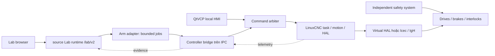

# Cánh tay 6-DOF, controller và đường tới phần cứng

**Ngày:** 2026-11-05 · **Trạng thái:** đề xuất để review; chưa triển khai, chưa hardware-qualified.
**Cơ sở:** `MEKONIQ-6DOF-Architecture-Technical-Spec-v1.md` ngày 2026-11-04 và primary sources đã kiểm tra ở phụ lục. Tài liệu này cụ thể hóa boundary tích hợp Lab; không thay thiết kế cơ điện, risk assessment hoặc commissioning của robot.

## 1. Quyết định và phạm vi

LinuxCNC chạy trên Linux đảm nhiệm interpreter, trajectory, kinematics và HAL. QtVCP/PyQt5 là HMI local; MEKONIQ Lab quản lý mô hình, scenario, thử nghiệm và evidence ngoài servo loop. MVP dùng PUMA 560 tham chiếu, LinuxCNC thật với virtual HAL, có thể phát triển trên Debian VM/PC không có EtherCAT. Chưa chọn robot MEKONIQ thật, drive, IPC hay safety circuit. [A1][A2][A3][A16]

Code platform mới thuộc `source/`. Boundary đầu tiên được đề xuất là `source/integrations/arm-controller/`: tự chứa Python bridge, QtVCP assets, INI/HAL, model manifests, packaging và tests, xuất thành controller package cài độc lập trên IPC. Không buộc tạo repository mới ngay; có thể tách sau khi contract/versioning ổn định. Lab chỉ chứa authoring, viewer, scenario và client. Không sửa `trial/`, robot đang chạy hay cổng 1880/1884.

MVP ưu tiên **coffee cell: máy pha cà phê, đá/sữa và arm phục vụ**. Bao gồm model/frame contract, six-joint telemetry, approved program execution trong controller simulation, trạng thái/fault/recovery, handoff evidence và báo cáo theo fidelity. Full release **R-SIM bắt buộc có geometric collision checker** cho arm self/scene và swept path của cup đang gắn với gripper. Collision planning tự động, dynamic force/torque/fluid simulation, ros2_control hardware driver, Cartesian teleoperation từ trình duyệt và live robot operation chưa thuộc MVP.

Reference flow: xác nhận cup/recipe → máy pha ready và brew có observation hoàn tất → đá/sữa theo recipe với quantity và trạng thái thiết bị → xác nhận chất lượng/cup tại pickup zone → arm giữ cup chắc → handoff có evidence. Recipe quyết định thứ tự brew/ice/milk, không mặc định mọi ly có cùng sequence. PUMA tham chiếu chỉ để test controller; reach/clearance tại quầy cà phê thật phải kiểm bằng robot, gripper, cup và layout revision thực tế.

## 2. Public mode và backend của một run

`mock`, `simulation`, `hardware` là ba public modes dùng chung với spec tổng. Khi tạo run, chốt bộ backend, model revisions, capability set, clocks và hardware stage vào manifest bất biến. Không đổi backend hoặc nâng mode giữa run; muốn đổi phải kết thúc run và tạo run mới. API `/lab/v2` là **đề xuất**, không mô tả API hiện đã tồn tại.

| Public mode / cấu hình | Thực thi | Có thể chứng minh | Không được suy diễn |
|---|---|---|---|
| `mock` + arm mock | State machine + FK/seeded numerical IK tham chiếu + joint trajectory theo F02 | UX, contract, model FK/IK/limits/singularity, command rejection, nghiệp vụ source | LinuxCNC execution, physical IK/accuracy, collision khi chưa có checker, dynamics, servo timing |
| `simulation` + `linuxcnc_sim` | LinuxCNC interpreter/motion/genserkins, virtual HAL trên Linux | Controller state, program, FK/IK theo model, mô phỏng home/jog local, fault sequence | Drive tuning, real-time IPC, tải/phanh, an toàn phần cứng |
| `simulation` + `gazebo_nav2` | Backend robot di động; arm chỉ có evidence nếu thêm arm model/physics adapter rõ ràng | Navigation/physics theo plugin và scene đã pin | Tự động có arm controller hoặc đã chạy LinuxCNC |
| `hardware` + `shadow` | Đọc telemetry, không phát actuator command | Mapping, độ mới dữ liệu, quan sát sai lệch với model | Đã kiểm chứng khả năng điều khiển |
| `hardware` + `hil` | Bench đã cấp quyền; drive/I/O thật, tải và fixture xác định | PDO/state machine/watchdog/timing trong phạm vi bench | Cell đã nghiệm thu, tải/cycle sản xuất |
| `hardware` + `live` | Controller local trên cell đã commissioning | Chỉ các claims có FAT/SAT và evidence đúng revision | Chứng nhận phổ quát hoặc mọi tool/payload/site |

`UI_MOCK`, `LINUXCNC_SIM`, `PHYSICS_SIM` trong tài liệu kiến trúc cũ là mô tả fidelity/backend; không thêm public mode thứ tư. Nếu run phối hợp mobile Gazebo và LinuxCNC arm, manifest phải ghi cả hai backend và nguồn observation cho từng asset. Không gộp thành một nhãn “digital twin verified”.

## 3. Model và đơn vị

`AssetRevision` dùng contract chung: joint names/order, link geometry, base/flange/TCP frames, kinematic model revision, collision geometry, source/provenance, calibration state và capabilities. SI tại boundary Lab: m, rad, s, kg; coffee volume m³ và temperature K, UI đổi ml/°C. Pose dùng quaternion `[x,y,z,w]` theo [contract chung](architecture-contracts.md), frame ID và timestamp. Không truyền mảng sáu số thiếu joint names hoặc thiếu đơn vị. Payload/gear/brake/encoder còn thiếu phải là `unknown`, không sinh giá trị có vẻ đã đo.

PUMA tham chiếu không phải robot MEKONIQ đã sản xuất. Sample LinuxCNC nhánh 2.9 được kiểm tra dùng inch, degree và startup `G20`; bridge phải đọc/pin unit configuration rồi đổi SI. Không đổi riêng một dòng `LINEAR_UNITS` mà giữ DH, offsets, velocity, tool và program cũ. `genserkins` dùng **modified DH theo Craig**, không mặc định dùng bảng standard DH. ALPHA trong sample DH là radian; joint command/feedback của sample là degree. [A3][A4][A5][A6]

Quy tắc chuyển đổi phải test hai chiều: inch → m ×0.0254; degree → rad ×π/180. Controller ABC được đổi sang quaternion theo chính convention đã kiểm tra của phiên bản controller; không giả định ABC là ba joint cổ tay. Tách `q_actual`, `q_commanded`, Cartesian pose, work offset và TCP offset. `actual_position` của Python API là trajectory pose; joint feedback lấy trường joint tương ứng. [A7]

Model manifest chứa hash của DH/URDF/meshes, tên convention, mapping joint0→J1, zero offset, axis sign, profile units và tool revision. DH/URDF/viewer phải đi qua independent FK checks tại nhiều cấu hình; không dùng cùng một hàm cho cả expected và actual. Mặc định fixture tham chiếu: FK consistency ≤1e-6 m và ≤1e-6 rad; IK residual ≤0.001 m và ≤0.0087266463 rad, kèm limit/continuity checks. Đây là dung sai số của fixture, không là accuracy/repeatability cơ khí. Mọi run phải ghi numeric tolerances của profile; không pass nếu chưa có threshold.

IK cần seed/configuration continuity, giới hạn từng joint, velocity/acceleration, wrist flips, wrap và điểm gần singularity. Sample PUMA đặt HOME của JOINT_4 là 0.1° để tránh inverse failure; điều này là cảnh báo phải test singularity, không là mẹo xử lý an toàn cho mọi robot. Không hứa mọi Cartesian pose/path hợp lệ khi chỉ endpoint đạt IK. [A3]

## 4. Kiến trúc và quyền phát lệnh

QtVCP hiển thị `.ui` và handler Python; cấu hình fullscreen `DISPLAY = qtvcp -f mekoniq_arm` phải được smoke-test với package đã pin. Cả QtVCP và bridge là non-real-time clients; không đưa HTTP, Python service hay rendering vào cyclic HAL execution. [A1]

**Một control owner tại một thời điểm.** Arbiter nằm local controller, là nơi duy nhất phát operational command vào LinuxCNC. Các owner: `none`, `local_operator`, `lab_simulation`, `authorized_cell_job`. Local HMI không giữ command path song song vượt qua arbiter. Physical safety path luôn độc lập, không tham gia tranh quyền này.

Owner acquire/release cần controller epoch, lease, actor, machine/profile và trạng thái authoritative; không dựa vào trạng thái browser. Chuyển owner chỉ khi controller idle/disabled theo profile và không còn command chưa xác định kết quả. Local operator có thể thu hồi quyền; việc thu hồi trước hết đi qua stop/cancel policy đã chốt, không nhảy sang lệnh mới. Lease hết hạn khóa lệnh tiếp theo và yêu cầu reconciliation; phản ứng đối với chuyển động đang chạy phải được controls engineer định nghĩa và test, không tự nhận network timeout tạo safety stop.

Trong `simulation`, Lab được submit program ID đã kiểm duyệt, start/pause/resume/cancel job và fault fixture được allowlist. Joint jog phục vụ commissioning nằm tại QtVCP local; browser Lab không phát physical jog hay servo setpoint. Với `hardware`, shadow chỉ đọc; hil/live chỉ nhận job cấp cao được capability, local enable và release gate cho phép. Không điều khiển máy qua Internet trong MVP.

Bridge local ưu tiên Unix-domain socket cố định, filesystem ACL và schema allowlist; runtime gọi adapter qua provider ID do provisioning quản lý. Với Lab ở máy khác, cần connector xác thực trên management network được provision trước; không cho browser nhập IP/URL/shell rồi gọi trực tiếp IPC. EtherCAT NIC tách management network. Scope ban đầu dùng Linux runtime cùng host bridge cho simulation; remote connector có gate riêng.

## 5. Contract bridge và failure semantics

Bridge contract là transport nội bộ riêng; không expose nguyên LinuxCNC Python/HAL API dưới `/lab/v2`. Envelope có request/command ID, run ID, machine ID, controller epoch, actor/owner token, expiry, program revision/hash và expected profile/model. Tên message đề xuất `arm.command.v1`, `arm.status.v1`, `arm.event.v1`; shared schema trong source là authority khi triển khai. `source/packages/cell-adapters` sở hữu common cell adapter contract; arm schema là typed payload được compose vào `cell-command`/`cell-observation`, không là envelope authorization cạnh tranh.

Allowlist bounded operations: status/capabilities; stage approved program; start/pause/resume/cancel job trong trạng thái hợp lệ; query command outcome. Reject arbitrary G-code text, MDI, `halcmd`, file path, Python/plugin, socket/network endpoint và raw PDO từ caller. Program staging kiểm hash/allowlisted M-code và tool/profile; một file G-code là nội dung có side effects, không chỉ là văn bản chuyển động.

| Tình huống | Hành vi bắt buộc |
|---|---|
| Duplicate command ID + cùng payload | Trả kết quả cũ/trạng thái pending; không gửi lần hai xuống controller |
| Cùng ID, payload khác | Conflict và audit; không chạy |
| ACK nhận lệnh | Chỉ là accepted; completion cần observation controller phù hợp |
| Timeout sau khi gửi | `outcome_unknown`; query/reconcile, không tự retry start/grip/transfer |
| Telemetry quá hạn / sai epoch | Đánh dấu stale/unknown; không giữ màu ready, không dùng để confirm transfer |
| Bridge/HMI restart | Owner token cũ mất hiệu lực; khôi phục journal và reconcile controller trước command mới |
| Controller reboot | Epoch mới, home/state validity đánh giá lại; không tự resume program |
| Fault/safety demand | Không chuyển trực tiếp về running; recovery và command mới cần preconditions hiện tại |

Bounded channel có giới hạn message size, queue depth và rate theo profile; telemetry backpressure được drop/coalesce với sequence-gap marker, command không được drop âm thầm. Wall-clock UTC phục vụ audit; monotonic clock phục vụ age/deadline; sim clock không thay deadline host cho lease. Bridge là consumer duy nhất của error channel rồi fan-out events cho HMI/Lab, tránh nhiều clients làm mất error lẫn nhau. [A7]

Arm phát evidence về pose/gripper/cup presence/transfer zone theo sensor capability. Beverage domain của source sở hữu cup/batch và xác nhận transfer; ACK `grip` hoặc arm tới waypoint không tự tăng served, không tự chuyển ownership. Nếu thiếu sensor hoặc feedback, kết quả là `unverified`/`unknown`; mock evidence phải mang nguồn mock.

Với coffee cell, pickup bị chặn khi brew/dispense còn hoạt động, máy pha/ice/milk device fault, cup chưa được xác minh, gripper chưa secure hoặc station interlock/cleaning chưa sẵn sàng. ACK brew không phải coffee ready; arm pose không phải cup retained. Handoff cần đích nhận ready, cup identity/recipe đúng, grip/release evidence và ownership transaction của source. Mất feedback giữa lúc đang giữ ly chuyển sang recovery với cup ownership chưa giải quyết; không tự thả ly hay đánh dấu served.

## 6. Vismach, physics và MoveIt

Vismach/PUMA GUI giúp xem joint pose; không dùng rendering hoặc mesh giao nhau làm test collision. LinuxCNC core ở scope này không cung cấp environment collision-aware planning. Vì vậy program phải dùng envelope/fixture được kiểm trước; UI không được tuyên bố “collision free” chỉ vì G-code preview thành công. [A2][A8]

**Geometric checker là dependency bắt buộc của R-SIM**, do SIM-05 và Task 6 của [plan simulation](../../plans/2026-11-05-digital-twin/02-simulation.md) xây dựng; arm adapter A05 cấp joint/attachment trace và nhận kết quả. Checker phải kiểm self-collision, arm với scene/fixture/AMR, và cup gắn gripper dọc đường chuyển động, không chỉ hai endpoint. Dùng collision geometry, joint/frame mapping, scene revision, cup attachment transform và trace time alignment đúng manifest. Contact được phép giữa gripper/cup hoặc cup/đích nhận phải được allowlist theo phase; không tắt toàn bộ cặp collision để làm scenario xanh.

Evidence ARM03 chứa engine/checker version, geometry hashes, trajectory/time span, attachment intervals, cặp geometry, collision/separation result và phương pháp swept-path coverage. Nếu kiểm bằng sampling, profile phải ghi numeric step/motion bound + conservative clearance policy và test thin-obstacle crossing giữa samples; không diễn giải sampling tùy ý thành continuous clearance. Missing geometry, incomplete trace, sai revision hoặc checker không chạy cho kết quả `not_run`/`blocked_external` và **chặn full R-SIM**. ARM03 cần negative collision fixtures được phát hiện/chặn đúng và nominal transfer không có forbidden collision. Có thể đạt PoC controller LinuxCNC hẹp khi ARM03 chưa chạy, nhưng phải ghi rõ PoC đó chưa đạt R-SIM.

Gazebo optional cần model có mass/inertia, collision mesh, joint/friction/drive approximation, timestep và engine revision. Theo documentation Gazebo Sim 8, physics engine chọn được và DART là mặc định; behavior còn phụ thuộc plugin/config. Chỉ chiếu joint trace của LinuxCNC vào Gazebo là replay/geometry observation. Closed-loop plant simulation cần command→plant→feedback, step synchronization, reset/clock/causality và following-error model được thiết kế riêng. Không cho LinuxCNC và ros2_control đồng thời ghi cùng joint. [A9]

Co-simulation MVP vận hành **1× với barriers** tại cup-ready, arm-transfer-complete và AMR-docked, theo architecture contract. LinuxCNC SIM dùng controller wall time; không hứa step/seek hay accelerated lockstep với Gazebo. Pause cần provider acknowledgments, thiếu ack là partial/unknown; mất provider không tự cho transfer tiếp tục. Closed-loop plant coupling ở trên là nghiên cứu bổ sung, không điều kiện để chạy controller SIM MVP.

MoveIt 2 có thể bổ sung planning scene/collision-aware trajectory ở pha sau. Nó cần URDF/SRDF, joint limits và controller interface; `FollowJointTrajectory` không tự là adapter LinuxCNC. Phải xác định ai time-parameterize, ai interpolate, tolerance/cancel/feedback mapping và ownership trước khi dùng. Không gửi lại trajectory samples bằng HTTP như servo loop. Chưa buộc Gazebo/ROS 2/MoveIt vào dependency của MVP LinuxCNC. [A10][A11]

## 7. EtherCAT, safety và readiness

Reference hardware stack: LinuxCNC → lcec HAL → IgH master → dedicated NIC → drives. IgH upstream thuộc EtherLab, source trên GitLab; trang chính thức hiện khuyến nghị `stable-1.6`. Repository `linuxcnc-ethercat/ethercat` cần đánh giá provenance/diff nếu chọn dùng, không ghi là upstream gốc. lcec candidate là community repository `linuxcnc-ethercat/linuxcnc-ethercat`; `sittner/linuxcnc-ethercat` đã archived và hướng người dùng sang community fork. Chọn branch chưa đủ: release cần commit/package hash, kernel, NIC, firmware và license inventory đã pin. [A12][A13][A14]

CiA 402, CSP/CSV, PDO, DC sync và cycle time phụ thuộc drive manual/firmware cụ thể. Không chốt “1 ms đạt production” từ sample. HIL phải đo servo latency, EtherCAT cycle/jitter/loss và response under load trên IPC thật; số liệu software-stepping trong tài liệu latency không được dùng nguyên làm EtherCAT acceptance threshold. [A15]

Safety relay/controller, E-stop, guards, enabling device, STO và phanh được thiết kế độc lập theo risk assessment của máy/cell. STO không mặc nhiên giữ tải trọng lực. Lab E-stop fixture và LinuxCNC software state chỉ kiểm logic phần mềm. Safety-rated functions, PL/SIL và yêu cầu thị trường do người có năng lực xác định, có validation riêng; không có chứng nhận suy ra từ simulator, OSS stack hoặc checklist này.

Coffee cell bổ sung hazards phải đánh giá: bề mặt/nước/cà phê nóng, ly trượt/vỡ/tràn khi đổi gia tốc, kẹp ở gripper và cửa máy, vòi/khay đang brew, ice jam, sữa và bề mặt tiếp xúc thực phẩm, vệ sinh/cleaning cycle và giao cắt người vận hành. Digital twin MVP không mô phỏng nhiệt/chảy tràn hoặc chứng minh vệ sinh thực phẩm. Vendor manuals và thử nghiệm phải chốt allowable cup/mass/fill, gripping force/contact, acceleration, temperature/handling policy, cleaning materials/cycle và sữa cold-handling metadata trước live. Chưa có numeric limit thì profile hardware bị chặn; không lấy số giả lập làm mức an toàn thật. Safety interlocks local vẫn hiệu lực khi Lab mất kết nối.

| Gate | Evidence cần có | Người chịu trách nhiệm | Trạng thái hôm nay |
|---|---|---|---|
| Controller PoC | Pinned Linux image/config, controller/kinematic cases, logs và unit/frame consistency; scope hẹp không thay R-SIM | Controls + software | Chưa chạy cho spec này |
| Full R-SIM | Controller + Gazebo/Nav2 + coffee I/O tích hợp; ARM03 geometric self/scene/attached-cup swept-path checker thực chạy và toàn bộ scenario gate đạt | Robotics + controls + QA | Chưa đạt |
| Shadow | Sensor mapping, timestamps, signed identity, không có command path | Controls + integration | Chưa đạt |
| HIL | Drive/NIC/PDO/profile, electrical checks, guarded bench, watchdog/disconnect/recovery tests | Electrical + controls + safety | Chưa đạt |
| FAT | Calibrated robot/tool, payload/envelope, repeatability, stopping/brake/interlock validation, software restore | Manufacturer + QA + safety | Chưa đạt |
| SAT/live | Site layout/tool/process đúng revision, guarding/operations/training, recovery và handoff tests tại site | Integrator + site owner + safety | Chưa đạt |

FAT/SAT áp dụng đúng serial/config/tool/site; đổi các thành phần liên quan làm evidence hết hiệu lực theo impact review. Readiness là tập evidence và unresolved items, không là một nút “qualified”. Installer default SIM; hardware enable là provisioning controlled riêng, không nằm trong imported Lab candidate. Production image phải có license/SBOM review của LinuxCNC, Qt/PyQt, lcec, IgH và components thực tế phân phối.

## 8. Yêu cầu và traceability

| ID | Yêu cầu kiểm được | Verification |
|---|---|---|
| ARM-01 | AssetRevision giữ model/provenance, SI và joint/frame mapping; thiếu geometry không nhận reach claim | ARM01 + contract fixtures |
| ARM-02 | LinuxCNC simulation chạy không drive/NIC EtherCAT; public mode/backend không đổi giữa run | Linux smoke + manifest checks |
| ARM-03 | Independent FK/IK, unreachable, limits, continuity/singularity/velocity có numeric acceptance và source trace | ARM01, ARM02, ARM04 |
| ARM-04 | Full R-SIM cần geometric self/scene/attached-cup swept-path checker, engine/geometry/trace provenance; thiếu checker làm ARM03 not_run và chặn R-SIM, viewer không tạo pass | ARM03 + SIM-05 |
| ARM-05 | One owner; local HMI và bridge cùng arbitration; Lab không có raw actuator/jog path | Concurrency/security tests |
| ARM-06 | Idempotency, timeout unknown, epoch, stale data và restart reconciliation | ARM05, ARM06 |
| ARM-07 | Trace phân biệt commanded/actual và lifecycle accepted/completed; lỗi không tự resume | ARM05, ARM06 |
| ARM-08 | Handoff evidence có source; Beverage domain mới quyết định transfer/served | BV01, BV07 |
| ARM-09 | Coffee pickup yêu cầu brew/ice/milk hoàn tất theo recipe, cup/grip/zone/interlock có evidence mới; mất grip/unknown không tự served | BV01, BV03, BV04, BV07, BV08 |
| HW-01 | shadow/hil/live chỉ ở new run với stage capability và evidence gate riêng | Contract + policy tests |
| HW-02 | Driver/master/kernel/NIC/PDO/firmware/version pin và tested compatibility | HIL matrix |
| HW-03 | Timing/watchdog/loss-of-link/power recovery có budget và report trên IPC/drive thật | HIL/FAT |
| HW-04 | Safety độc lập, gravity/brake/guard/enabling/reset được risk-assessed và validated | Qualified hardware validation |
| HW-05 | Release/package/identity/calibration/rollback/license traceable; không auto enable | Install + restore + audit |
| HW-06 | FAT/SAT theo machine/tool/site, change invalidation; không suy readiness từ simulation | Release review |
| HW-07 | Coffee hot-liquid/surface, cup retention, food-contact/cleaning và milk-handling constraints có vendor/measurement-backed profile; thiếu limits chặn live | Coffee-cell FAT/SAT |

Scenario ARM01..ARM06 và BV01/BV07 lấy từ [verification.md](verification.md); yêu cầu `ARM-01` là requirement ID, khác `ARM01` là scenario ID. Kế hoạch triển khai tương ứng tại [03-arm-hardware.md](../../plans/2026-11-05-digital-twin/03-arm-hardware.md).

## 9. Primary references và provenance

Các nguồn sau được truy cập kiểm tra **2026-11-05**. URL branch/stable/rolling có thể thay đổi; implementation phải resolve commit/package hash, không dùng ngày kiểm tra như dependency lock. Không có controller/physics/hardware test được thực hiện trong lần viết spec này.

| Ref | Nguồn | Điểm đã kiểm chứng |
|---|---|---|
| A1 | [LinuxCNC QtVCP](https://linuxcnc.org/docs/html/gui/qtvcp.html) | .ui/handler, PyQt5, DISPLAY pattern và fullscreen option |
| A2 | [Switchable kinematics](https://linuxcnc.org/docs/html/motion/switchkins.html) | PUMA560/genserkins simulation không hardware; switching phải xử lý synchronization/offset/limits |
| A3 | [PUMA560 INI, LinuxCNC 2.9 branch](https://raw.githubusercontent.com/LinuxCNC/linuxcnc/2.9/configs/sim/axis/vismach/puma/puma560.ini) | Six joints, inch/deg, G20, virtual HAL, JOINT_4 home tránh inverse failure |
| A4 | [genserkins reference](https://linuxcnc.org/docs/html/man/man9/genserkins.9.html) | Serial kinematics, modified Craig DH |
| A5 | [DH modeling guide](https://linuxcnc.org/docs/html/motion/dh-parameters.html) | Model phải đúng convention; Vismach cần model phù hợp riêng |
| A6 | [PUMA560 DH source](https://raw.githubusercontent.com/LinuxCNC/linuxcnc/2.9/configs/sim/axis/vismach/puma/puma560_dh.hal) | Geometry/ALPHA sample để đối chiếu unit conversions |
| A7 | [LinuxCNC Python interface](https://linuxcnc.org/docs/html/config/python-interface.html) | Command/stat/error channels, trạng thái authoritative và machine-unit fields |
| A8 | [PUMA560 Vismach GUI](https://linuxcnc.org/docs/html/man/man1/puma560gui.1.html) | Đây là sample visualization |
| A9 | [Gazebo Sim 8 physics engines](https://gazebosim.org/api/sim/8/physics.html) | Runtime engine selection, DART default, plugin limitations |
| A10 | [MoveIt low-level controllers](https://moveit.picknik.ai/main/doc/examples/controller_configuration/controller_configuration_tutorial.html) | Controller action interface tách khỏi planner; custom adapter cần triển khai |
| A11 | [gz_ros2_control Jazzy](https://control.ros.org/jazzy/doc/gz_ros2_control/doc/index.html) | Plugin instantiates controller manager cho Gazebo model; version compatibility phải pin |
| A12 | [IgH EtherLab upstream](https://etherlab.org/en_GB/ethercat) | GitLab upstream, khuyến nghị stable-1.6 tại ngày kiểm tra |
| A13 | [lcec community repository](https://github.com/linuxcnc-ethercat/linuxcnc-ethercat) | HAL driver, XML/PDO mapping; build phụ thuộc EtherCAT master |
| A14 | [Historical sittner repository](https://github.com/sittner/linuxcnc-ethercat) | Archived, chỉ dẫn chuyển sang community fork |
| A15 | [LinuxCNC latency testing](https://linuxcnc.org/docs/stable/html/install/latency-test.html) | Đo trên máy thật dưới tải; không chạy latency test đồng thời LinuxCNC |
| A16 | [LinuxCNC system requirements](https://www.linuxcnc.org/docs/stable/html/getting-started/system-requirements.html) | Simulation được chạy stock kernel; real machine cần realtime kernel |
