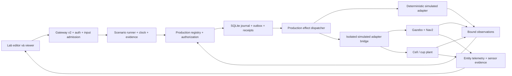
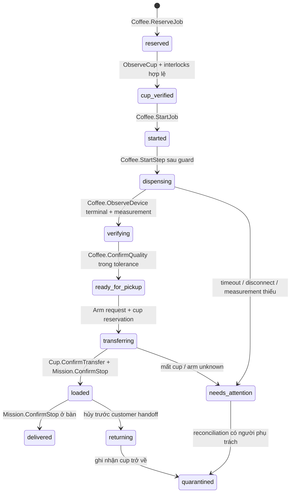

# Mô phỏng giao món, đồ uống và tương tác trong nhà hàng

Trạng thái: **đề xuất thiết kế ngày 2026-11-05; chưa triển khai, chưa có kết quả SIL mới**. Tài liệu này quy định phần mô phỏng của Digital Twin Lab. Hợp đồng chung và ba mode công khai nằm trong [architecture-contracts.md](architecture-contracts.md); kịch bản và tiêu chí nghiệm thu nằm trong [verification.md](verification.md). Kế hoạch thực hiện là [02-simulation.md](../../plans/2026-11-05-digital-twin/02-simulation.md).

## 1. Hiện trạng làm cơ sở

Các đường dẫn dưới đây tính từ thư mục workspace chứa các repo `lab/`, `source/`, `trial/`. Đây là kết quả đọc mã, không phải xác nhận đã chạy lại toàn bộ test.

| Thành phần hiện có | Điểm nối cần giữ | Giới hạn hiện tại |
|---|---|---|
| `source/packages/lab-runtime/src/session.ts` | `LabSession`, `createLabSession()`, `command()`, `observe()`, `dispatch()`, `report()` | Chỉ `business_sim` / `S01`; `start()` cố định `lab-meal`, `table-1`, `kitchen`, `sim-1`; snapshot chỉ một robot/một fulfillment line |
| `source/packages/lab-runtime/src/fixture.ts` | Khởi tạo venue tổng hợp, catalog, station, binding cùng world revision | Một station, một robot; battery 100; không có recipe/cup/cell/device |
| `source/packages/robot-adapters/src/contract.ts` | `RobotAdapter.describe/execute/cancel/requestStop/observe/reconcile`, `RobotEvent`, `TargetBinding` | Contract di chuyển; không biểu diễn định lượng, cốc hoặc tay máy |
| `source/packages/robot-adapters/src/simulator.ts` | Dedupe command, fault offline/blocked/reboot, observation có boot/sequence | Thời gian mỗi leg mặc định 1.000 ms; không tuyến đường, động lực học, sensor, vật cản hoặc battery consumption |
| `source/packages/robot-adapters/src/dispatch.ts` | `dispatchRobotEffects()` journal trước dispatch; execute không gửi lại khi kết quả unknown; chặn reservation/control epoch | Không biến uncertainty thành arrival; ACK STOP không chứng minh dừng vật lý |
| `source/packages/domain/src/fleet/mission.ts` | `createMission()` gom allocation theo station rồi table; queue; load/handoff; cancel có cargo thì return/unload | `trays` đang đếm allocation, không có packing/slot theo thể tích; chưa có beverage cell |
| `source/packages/domain/src/kitchen/ticket.ts` | `Kitchen.Accept`, `Kitchen.Ready`, partial readiness; nhiều station của một món dùng lượng tối thiểu đã hoàn thành | Readiness theo phần ăn, không xác thực định lượng chất lỏng |
| `source/robotics/agent/mekoniq_agent/nav2_adapter.py`, `nav2_rclpy.py` | `Nav2Config`, `Localization`, `ActionClient`, `GoalState`; `NavigateToPose` với goal UUID; kiểm lifecycle/map/covariance | Có port và test Python; chưa kết nối với HTTP Lab, không tự cung cấp bằng chứng hardware |
| `source/robotics/simulation/worlds/generate_restaurant.py` | Sinh SDF và occupancy từ cùng danh sách vật thể | World 12 × 8 m cố định, bốn bàn, walker/blocker; không biên dịch project Lab |
| `trial/data/lib/route.js`, `simulator.js` | Tham khảo graph Dijkstra, slow/one-way/narrow lane, cảm nhận vật cản và nhường đường | Point-mass prototype; không mang sang như production journal hoặc chứng nhận va chạm |
| `trial/data/site.demo.json`, `orchestrator.js` | Menu món chính → kitchen, đồ uống → bar; confirm load/handoff, trả món khi hủy | Nghiệp vụ prototype tham khảo UX; source domain vẫn là nơi quyết định nghiệp vụ mới |

V1 phải được giữ nguyên. `lab-project.schema.json` không cho thuộc tính ngoài, `lab-run.schema.json` chỉ cho S01/business_sim, deployment v1 chỉ là draft và evidence không xác minh. Mở rộng bằng schema v2 mới và `/lab/v2`; không nhét trường v2 vào project v1. Exporter hiện hash tên và byte của **toàn bộ** schema; cập nhật artifact/lock và negotiation phải là một bước có kiểm tra. Manifest mới theo hợp đồng gốc có `protocolMajor:2`, `protocolMajors:[1,2]`; UI v1 cũ tiếp tục dùng artifact v1 đã pin.

## 2. Mục tiêu và yêu cầu

Một mô hình nhà hàng có thể chạy nghiệp vụ giao món/đồ uống bằng mock trên máy phát triển, chạy cùng nghiệp vụ với plant mô phỏng, và được dùng làm đầu vào chuẩn bị hardware. Mỗi run ghi rõ điều gì đã được thực thi, giá trị nào do model tạo ra và phạm vi chưa kiểm chứng.

| ID | Yêu cầu bắt buộc | Bằng chứng cần tạo |
|---|---|---|
| SIM-01 | Dùng production registry, authorization, journal, effect dispatcher và mission state machine của source cho mock/SIL | Journal + receipt + source commit; kiểm test có dùng production entrypoints |
| SIM-02 | Mock đóng gói chạy Node 24 trên macOS/Linux, không cần ROS, Docker hay hardware; seed + input pin tạo cùng trace nghiệp vụ chuẩn hóa | Hai run có cùng normalized business trace hash; không so UUID/chữ ký ngẫu nhiên |
| SIM-03 | Biên dịch `AssetRevision` dùng chung ra scene, collision, occupancy, bindings và manifest từ một revision bất biến | Hash đầu vào/đầu ra và kiểm parity; world bounds/units/frame rõ ràng |
| SIM-04 | SIL Nav2 chỉ phát arrival từ goal terminal thành công hợp lệ; ACK, distance nhỏ, animation kết thúc không phải arrival | Raw goal UUID/status/result, localization/map identity, source observation |
| SIM-05 | Sensor, vật cản, người đi lại, footprint, contact và vùng giao nhận có model và provenance | Contact trace, min separation, sensor coverage, physics timestep/model version |
| SIM-06 | Hai robot trong cùng world có namespace, command identity và reservation riêng; tranh chấp corridor không làm mất quyền sở hữu | FD07 với overlap vùng độc quyền bằng 0, không deadlock im lặng |
| SIM-07 | Pause/step/reset, fault schedule và time mapping không phá trình tự nguồn; mất backend là unknown | Clock trace, restart/disconnect tests, không phát lại execute tự động |
| SIM-08 | Report phân biệt mock, SIL, open-loop visualization, closed-loop plant và hardware evidence | Provenance từng metric/measurement, limitations và readiness độc lập |
| SIM-09 | Gateway v2 nhận input kiểu hóa, bind actor/session/run, không nhận tùy ý ROS topic, shell, endpoint hoặc raw business command | Contract/security tests; run backend set bất biến |
| SIM-10 | Bộ FD01–FD08 và campaign food+beverage chạy trên backend đã khai báo; không fallback khi thiếu backend | Scenario result với backend version, seed, input hash, pass/fail/not_run |

Mode công khai chỉ có `mock`, `simulation`, `hardware`. Server resolve `backendSetId` rồi khóa tập backend khi tạo run: mock dùng `mock_amr`, `mock_coffee`, `mock_arm` của packaged source runner; simulation dùng `gazebo_nav2`, `linuxcnc_sim`, `coffee_io_sim` theo kịch bản. Người dùng không đổi backend của run đang chạy. Replay là view chỉ đọc của bằng chứng run đã kết thúc, không phải mode điều khiển và không được mở actuator. `shadow`, `hil`, `live` là cấp truy cập hardware riêng theo kiến trúc chung.

## 3. Phân ranh runtime và dữ liệu

**Business truth** gồm order, prepared/ready/allocated/served quantity, mission stop, cargo ownership, cell reservation và reconciliation. Chỉ source domain qua `processCommand()` được thay đổi các giá trị này. `createProductionRegistry()`, `authorizeVenueCommand()` và quyền theo station tiếp tục áp dụng. Scenario runner tạo command kiểu hóa phía server với principal hạn chế theo vai trò; browser không tự chọn `actorRef`, `deviceId` hoặc quyền.

**Plant truth** gồm pose/velocity/joints/contact/cup sensor/weight/flow. Backend phát observation đã gắn run, entity, adapter boot, command, sequence, sim time. Lớp chuyển đổi kiểm danh tính và fresh evidence trước khi gọi domain. Entity telemetry v2 tách khỏi event nghiệp vụ: viewer có thể nội suy giữa hai pose nhưng không tạo `MissionArrived`, `CargoLoaded` hoặc `PortionServed`.

**Authoring truth** là `AssetRevision`, world revision, recipe revision và scenario revision. Snapshot bất biến của chúng được ghi trước khi run bắt đầu; chỉnh editor chỉ tạo revision mới. Report giữ toàn bộ references và hashes để kết luận cũ không bị gắn nhầm cấu hình mới.

SIL dùng adapter có `adapter:'simulator'`, profile `validation:'simulated'`, observer `simulator:<robotId>` do server quản lý trên owner device của venue tổng hợp. Bridge riêng gọi Gazebo/Nav2 trong môi trường mô phỏng; **không** đổi profile ROS thành `hardware_validated` để vượt admission. `profileReason()`, `eligibleRobots()`, observer ownership, control epoch và reservation của production không bị nới. Hardware tiếp tục đi qua native executor có journal của source/Android hoặc bridge đã được hợp đồng hardware phê duyệt.

## 4. Mock có tính lặp lại

Mock là runtime Node 24 xuất từ `source/`, cùng domain và persistence với ứng dụng. UI Lab chỉ render và gửi action cấp kịch bản. Không copy `trial/orchestrator.js` hoặc viết lại order/mission reducer trong browser.

Runner sử dụng fixed step 20 ms và virtual clock có `simTimeNs` nguyên dạng string theo contract v2; nội bộ scenario không đọc `Date.now()` để quyết định. Mọi lựa chọn ngẫu nhiên dùng PRNG có tên/version và seed; ID logic nghiệp vụ được ánh xạ từ scenario step ordinal. UUID runtime, khóa ký và session token vẫn ngẫu nhiên. So sánh trace chuẩn hóa bỏ trường transport/crypto ngẫu nhiên, giữ type, causal operation ordinal, quantities, identities cấu hình và logical timestamps.

Mock cần mô hình kinematic trên graph: node là vị trí robot phục vụ; edge có chiều, chiều rộng, tốc độ và closure; pose tiến theo đường tại fixed tick. Distances tính theo SI, ETA từ path length/speed và service duration. Battery, tải và beverage fill là model toán học có tham số và provenance; chỉ gọi tên “estimated/modelled”. Obstacle hoặc người đi ngang tạo hold/replan bằng luật model; không gắn nhãn kết quả là collision avoidance của hardware. Không có tuyến → `unreachable`; chưa biết native result → `unknown`, hai trạng thái khác nhau.

S01 v1 giữ nguyên test legacy. Các FD/BV v2 độc lập với tên/ID cố định `kitchen`, `table-1`, `sim-1`. Semantic role trong scenario tham chiếu entity ID của project đã resolve trước run. Runner hỗ trợ nhiều order, station, robot, cup và timeline command. Rate chỉnh playback không thay đổi virtual duration hoặc kết quả nghiệp vụ.

## 5. AssetRevision và world compiler

`AssetRevision` dùng đúng định nghĩa canonical trong architecture-contracts. Compiler cần tối thiểu reference đến visual mesh, collision primitives/mesh, kích thước SI, origin/frame, mass/inertia (nếu có dynamics), joints/limits (nếu có), sensor/extrinsic, semantic ports và provenance. Thiếu trường bắt buộc cho một backend làm backend đó unavailable với reason; không âm thầm lấy kích thước từ ảnh.

Một lần compile tạo các output trong run bundle riêng:

| Output | Nội dung |
|---|---|
| `world.sdf` | Vật thể có visual và collision từ cùng asset revision; pose scene cố định |
| `map.pgm`, `map.yaml`, `map.identity.json` | Occupancy của vật cản tĩnh cắt theo chiều cao robot; map hash/revision/frame/origin/resolution |
| `bindings.json` | Semantic handoff/loading/parking poses, có yaw và zone footprint; không dùng tâm bàn làm vị trí robot |
| `robot-<id>.urdf`, `nav2-<id>.yaml` | Hình học, inertia, footprint, sensor extrinsics và namespace của từng instance |
| `scene-index.json` | Mapping entity → asset revision → Gazebo entity/frame → telemetry channel |
| `compiler-manifest.json` | Compiler version, asset/input/output hashes, warnings, assumption list và backend compatibility |

Giữ raw occupancy riêng khỏi Nav2 inflation; inflation do robot footprint + clearance policy, tránh cộng trùng bán kính. Chuẩn default mới là `world`/`map` trong metre, yaw radian, z hướng lên. Offset/rotation giữa editor/world/map được biểu diễn bằng transform rõ ràng; pixel màn hình không được dùng làm tọa độ motion. Handoff pose phải ngoài furniture collision và chứa đủ footprint; đồ vật treo trên đầu/tầng khay cần collision 3D, không chỉ rectangle trên sàn.

Hiện tồn tại hai geometry minh họa khác nhau: Lab service footprint 0,55 × 0,60 m trong `packages/lab-runtime/src/geometry.ts`, robot Gazebo config chassis width 0,45 m/length 0,60 m. Không tuyên bố chúng là cùng robot. V2 chọn asset revision cụ thể làm nguồn chuẩn; v1 giữ nguyên; migration đánh dấu geometry cũ là illustrative và yêu cầu chọn asset trước SIL. Chassis `valetudo` v1 có footprint null, không suy ra đo đạc từ tên hãng.

## 6. Gazebo/Nav2 và hai robot

Baseline triển khai là image Ubuntu 24.04, ROS 2 Jazzy, Gazebo Harmonic được pin bằng digest và package lock trong source. Không dùng tag `latest`. Compiler thuần dữ liệu chạy được không có ROS; SIL runner thực thi trên Linux host/VM có prerequisites. UI và mock vẫn dùng được trên macOS. Headless rendering cần kiểm capability cụ thể; thiếu GPU/software renderer phù hợp trả unavailable và hướng dẫn prerequisite.

Mở rộng `restaurant_sim.launch.py` thành launch v2 nhận compiled bundle và danh sách instance. Mỗi robot có tên model duy nhất, namespace riêng (`robot_1`, `robot_2`), topic/action/TF riêng, Nav2 lifecycle riêng; map shared chỉ khi cùng map hash. One world physics clock phục vụ cả hai; không tạo hai world độc lập rồi ghép animation.

Dùng port `ActionClient` và kiểm terminal semantics của `nav2_adapter.py`: chỉ completed khi goal đã accepted, status `SUCCEEDED` và `result.error_code == 0`; aborted/canceled/mất result không hoàn thành. Bridge SIL tách khỏi executor hardware; có goal UUID durable và query-by-ID. Localization lifecycle, covariance, timestamp và map identity phải hợp lệ trước dispatch; mất localization đang đi dẫn tới hold/unknown theo sự kiện thực, không nhảy pose tới đích.

Gazebo có contact sensor và lidar model để tạo evidence; collision geometry cần được sensor pipeline nhìn thấy, không chỉ có mesh đẹp. Nav2 Collision Monitor có thể bổ sung kiểm tra vùng dừng ở đầu ra vận tốc; nó không thay E-stop vật lý. Cấu hình đúng thứ tự cmd_vel consumer và ghi sensor source/timeout theo [Gazebo Harmonic sensors](https://gazebosim.org/docs/harmonic/sensors/) và [Nav2 Collision Monitor](https://docs.nav2.org/rolling/tutorials/general_tutorials/using_collision_monitor/using_collision_monitor/). URL rolling chỉ là nguồn giải thích; cấu hình thi hành phải kiểm theo Jazzy đã pin.

Người đi lại là entity có collision capsule, trajectory và vận tốc giới hạn, seed và lịch xuất hiện cố định. Giai đoạn đầu chỉ script crossing/waiting/blocking, không nhận là mô hình hành vi con người đã hiệu chuẩn. Kịch bản FD03 phải có ít nhất crossing vuông góc đường đi, đứng yên bất ngờ và vật cản bị che khuất; report ghi min separation/contact/robot speed theo thời gian. Cho người xuyên tường hoặc teleport qua robot là fault injection, phải được ghi riêng.

FD07 thử hai robot vào corridor từ hai đầu. Production reservation là quyền được di chuyển; collision controller là phản ứng cục bộ. Giữ venue movement zone hiện có làm fallback bảo thủ. Nếu mở parallel granular zones, chỉ cho khi simulator profile thật sự thi hành grant; chưa có thì serial hóa và report throughput giới hạn. Unknown holder không được hết TTL rồi cấp cho robot khác. Tối thiểu một robot phải tiến triển khi corridor được mở; deadlock detection ghi reason và giữ quyền an toàn, không “cứu” bằng teleport.

## 7. Clock, faults và độ tin cậy

Mock fixed tick có thể lặp lại chính xác trace chuẩn hóa. SIL dùng `/clock`; fixed physics step, seed và package digest hỗ trợ lặp thí nghiệm nhưng **không cam kết bitwise deterministic** giữa CPU/GPU/OS. Nghiệm thu SIL dùng invariant và tolerance đã pin, báo dispersion của ít nhất ba lần chạy cùng seed cho metric định lượng.

Coordinator của run sở hữu clock authority. Mock step dùng tick 20 ms; Gazebo dùng `/clock`; LinuxCNC SIM dùng controller wall time. Co-simulation mặc định chạy 1× với semantic barriers tại cup-ready, arm-transfer-complete và AMR-docked, ghi timestamp mapping/skew/causality ID; **không cam kết deterministic lockstep từng physics/controller cycle**. Pause chỉ hiện hoàn tất sau hold ACK từ mọi backend; thiếu ACK là partial/unknown. Backend chưa hỗ trợ step trả capability `step:false`; UI không hiện step giả. Clock receipt monotonic phía gateway là cơ sở freshness, wall timestamp không phải ordering authority.

Inject fault qua enum và payload được kiểm schema: chặn/mở lane, xuất hiện pedestrian, sensor stale/drop, disconnect, reboot, localization loss, map revision change, duplicate/reordered observation. Không nhận arbitrary plugin/topic/file/command từ browser. Fault trước dispatch và fault sau accepted nhưng trước result phải là hai test khác nhau.

Khi mất bridge, actuator command outcome là unknown; giữ reservation/cargo/cup ownership. Recovery query command ID trước khi xét tiếp tục. Observation cũ boot/sequence/epoch không làm quay lùi state. Restart run không gửi lại dispense, arm cycle hoặc navigation uncertain. Reset tạo run mới với ID mới và xóa plant của chính run đó sau đóng, không sửa journal lịch sử.

## 8. Dây chuyền đồ uống

Ưu tiên người dùng đã chọn: **cà phê — máy pha, đá/sữa và arm phục vụ**. Hai recipe mẫu là espresso và cà phê sữa đá. Recipe định nghĩa thứ tự brew/ice/milk; không hardcode một thứ tự chung. Máy pha phải ready, cốc đúng và nguyên liệu đủ trước cycle; lượng cà phê/sữa/đá có measurement riêng; tay máy nhận cốc rồi bàn giao vào khay robot di động; robot đi tới bàn và staff/khách xác nhận nhận đồ uống. Recipe engine, cell/device resource và cup ownership là code production mới trong `source/`; Lab chỉ cấu hình, mô phỏng và xem evidence. Kinematics/LinuxCNC của arm được định nghĩa trong [arm-hardware.md](arm-hardware.md).

Các yêu cầu BV-01…BV-08 được định nghĩa duy nhất tại [product-experience.md](product-experience.md); bảng sau chỉ ánh xạ implementation/evidence, không định nghĩa lại yêu cầu.

| Requirement canonical | Điểm triển khai trong simulation |
|---|---|
| BV-01 | RecipeRevision và espresso/iced-milk-coffee fixtures; identity/frozen ordered steps |
| BV-02 | Coffee machine/cup/resource preflight; interlock observations từ coffee_io_sim |
| BV-03 | Brew/milk/ice target và measured quantity, tolerance/freshness/provenance |
| BV-04 | Arm choreography port, cup pickup/drop plant và command correlation |
| BV-05 | Cup transfer ledger, evidence bên giao/bên nhận, robot mission load/handoff |
| BV-06 | Device command idempotency, observation boot/sequence, unknown reconcile |
| BV-07 | Partial drink/cup recovery, cleaning/temperature/ingredient state và disposition |
| BV-08 | Source journal + device/controller/plant trace và recipe/model manifests |

Đề xuất module `source/packages/domain/src/beverage/` đăng ký qua production registry. Các aggregate mới cho recipe, CoffeeJob, cell/device, cup và resource dùng đúng tên/schema F04; command có scope/version/idempotency và quyền station theo cơ chế hiện có.

Luồng trạng thái CoffeeJob (tên nội bộ state được F04 sinh một lần):

Command canonical theo F04: `Coffee.RegisterRecipe`, `Coffee.ReserveJob`, `Coffee.ObserveCup`, `Coffee.StartJob`, `Coffee.StartStep`, `Coffee.ObserveDevice`, `Coffee.ConfirmQuality`, `Cup.RequestTransfer`, `Cup.ConfirmTransfer`, `Coffee.CancelJob`, `Coffee.Reconcile`, `Coffee.RecordCleaning`. Register/configuration và observations đều qua authorization/version guards; không có registry `Beverage.*` song song. ReserveJob giữ tài nguyên; StartJob chỉ bắt đầu khi cup/interlocks hợp lệ, StartStep phát typed effect `brew`, `dispense_milk`, `dispense_ice` hoặc arm `transfer`; mỗi step có command ID/quantity/evidence semantics riêng. Browser không gửi raw pump on/off.

`Coffee.ReserveJob` tham chiếu kitchen-ticket/order line có station bar, recipe revision, cup ID và quantities. `Coffee.ConfirmQuality` chỉ được chấp nhận sau đo xác minh: dùng helper domain của `Kitchen.Ready` trong cùng quyết định/transaction để phát `KitchenPortionsReady`/`ReadyQuantityAdded` và consumption hiện có; không tự cập nhật snapshot từ bridge. Dùng helper chung để bảo toàn partial readiness và multi-station minimum, không gọi nested `processCommand()` trong domain. `Fulfillment.Allocate` và `Mission.Create` tiếp tục sở hữu phân bổ/giao tới bàn; `served` chỉ tăng tại customer handoff. Job chỉ hoàn tất sau fulfillment cuối, quality verified không phải delivered.

Cup ownership khởi đầu `cell:<id>`, chuyển sang `arm:<id>` sau gripper closed + object-presence + lift/pose evidence, sang `robot:<id>/tray:<slot>` sau dock pose/velocity trong tolerance + destination presence + release evidence. Domain transition kiểm owner hiện tại, transfer ID, fencing epoch, fresh observations và recipe/cup identity. Ownership uncertain vẫn giữ owner cuối biết được cùng pending transfer; cấm “suy ra nhận” từ lệnh release ACK. Load confirmation của mission tham chiếu transfer đã hoàn tất; human override cần quyền, reason và audit, không giả sensor.

Canonical units theo architecture: volume m³, mass kg, temperature K; UI đổi sang ml/g/°C. Lượng nghiệp vụ dùng decimal string với scale khai báo và phép tính decimal/fixed-point chính xác; nội bộ adapter có thể dùng integer µl/mg rồi đổi tại boundary, không đưa field µl vào wire canonical. Nếu đổi giữa mass/volume phải có density + temperature/model assumption; không tự coi 1 ml = 1 g với mọi đồ uống. Đá dùng mass kg và geometry/fill assumption riêng, không coi một viên đá có thể tích cố định mặc định. Recipe/cup schema giới hạn capacity/headspace, tương thích nozzle/arm gripper/tray. Dose tolerance, milk temperature/cold-handling và hot-cup restrictions thuộc recipe/profile có revision và provenance, không lấy fixture làm ngưỡng hardware.

## 9. Plant đồ uống và coupling tay máy

Mock coffee cell mô phỏng machine ready/warmup/brew cycle, cup-present, milk pump/level, ice dispenser/jam, cumulative measurement, settling delay, tare, cleaning và temperature status theo virtual clock. `coffee_io_sim` nối cùng process model vào simulation run; Gazebo không tự cung cấp flow/brew state. SIL đặt cup collider trong world, nozzle, pickup pose, gripper/tray attachment và sensor zones. Contact/attachment event phải phản ánh transform có nguồn; scene không tự đổi parent khi domain muốn hoàn thành.

Giai đoạn đầu không mô phỏng fluid/thermal CFD. Liquid là quantity scalar + fill height + mass/inertia approximation; spill là mô hình nguy cơ theo acceleration/tilt/headspace, ghi `modelled`, không kết luận đồ uống không tràn ở đời thật. Temperature có source/provenance và quality; không có sensor/model hợp lệ giữ null/unknown và chặn bước cần xác minh nhiệt độ theo policy. Heat hazard, máy chưa ready, sữa hết, đá kẹt và cleaning overdue là trạng thái/interlock chức năng. Không gắn “an toàn thực phẩm” hoặc đã kiểm định nhiệt từ mô phỏng. Dry-run mock dùng ingredient/cup model phải hiển thị rõ.

`linuxcnc_sim` sở hữu controller/joint commands; Gazebo sở hữu plant khi coupling closed-loop được bật. Không cho ros2_control đồng thời điều khiển cùng joint. Trace joint LinuxCNC chỉ mirror/replay vào Gazebo được ghi `open_loop_visualization`: có thể cung cấp geometric self/scene/cup collision evidence nếu checker thực chạy và log engine/model, nhưng không chứng minh phản hồi servo hay dynamics closed-loop. Full simulation campaign cần checker hình học cho ARM03 và cup attachment; không có checker thì report partial coverage/ARM03 not_run. Full dynamics/force/closed-loop là capability bổ sung; chỉ ghi `closed_loop_simulation` khi có command → plant feedback tác động thực lên controller với mapping/skew/barriers được kiểm chứng, không suy từ scene chạy mượt.

Beverage cell bridge giao tiếp với arm qua port đã định nghĩa ở spec arm; adapter trả `accepted`, `running`, `completed`, `failed`, `unknown` và evidence refs. `completed` của arm có nghĩa choreography kết thúc theo controller; business transfer vẫn phải kiểm cup/dock evidence. Một run food+beverage dùng chung robot/corridor/tray resource và clock, không tổng hợp từ hai run độc lập.

## 10. Kịch bản và đầu ra

Các định nghĩa canonical ở verification; bảng dưới xác định phần mô phỏng phải cung cấp.

| Scenario | Đầu vào/fault chính | Điều kiện không được vi phạm |
|---|---|---|
| FD01 | Một món, một bàn, load/handoff có xác nhận | Served sau handoff, không theo timer |
| FD02 | Nhiều allocation, station/table; robot bận | Không giao trùng/mất phần, queue được giữ |
| FD03 | Pedestrian crossing/standing | Có contact/separation evidence; stop/replan được giải thích |
| FD04 | Lane blocked/no path | Không arrival giả, retry có giới hạn và reason |
| FD05 | Payload/battery/capability không phù hợp | Admission từ chối trước physical effect |
| FD06 | Hủy sau load | Cargo về hoặc needs_attention, served không tăng |
| FD07 | Hai robot corridor hẹp | Không đồng sở hữu vùng, không mất robot identity |
| FD08 | Map stale/localization loss | Giữ mission, không issue goal dùng binding cũ |
| BV01 | Espresso và cà phê sữa đá theo recipe → verify → arm → mobile | Espresso không chạy đá/sữa; recipe/cup identity và mọi transfer có evidence |
| BV02 | Cup absent/incorrect/removed | Không dose/pick khi thiếu điều kiện; liquid đã phát được ghi |
| BV03 | Sữa/nguyên liệu hết, đá kẹt, resource đang bị giữ | Reserve nguyên tử, partial quantity còn được giữ |
| BV04 | Brew/dose out-of-tolerance/timeout | Chặn ready; ghi actual measure + reason |
| BV05 | Brew/dose ACK thiếu/trùng, disconnect/reboot | Không brew/dose lần hai; unknown giữ resource |
| BV06 | Recipe/cup mismatch hoặc component sequence sai | Fail trước action không đảo ngược |
| BV07 | Pickup/dock/handoff timeout hoặc cancel có liquid | Không mất cup/cargo; recovery có audit |
| BV08 | Máy chưa ready, cleaning/milk cold-handling/interlock stale | Cell unavailable với reason, không tự bypass |

Campaign kết hợp dùng FD02 + FD07 + BV01 + BV03 để kiểm tài nguyên chung. SYS01–SYS06 kiểm seed/identity, reconnect/unknown, observation order, revised input/migration, replay không effects và unavailable không fallback. Không tạo ID scenario mới cho từng biến thể seed.

Report tối thiểu gồm input and artifact hashes; mode/backend/version; clock and seed; source event/journal/effects/attempts; per-entity telemetry; native result trace; resource/cup ownership timeline; contacts; min separation; route distance/time; battery/load model; dose target/actual/tolerance; recipe/cup/transfer IDs; failures và coverage limitations. Report có thể đánh dấu phần nghiệp vụ pass nhưng physics not_run; không tự gộp thành hardware ready. Gate A/B và production-release của source vẫn chưa được chấp nhận khi thiếu thiết bị, commissioning và venue acceptance.

## 11. Ranh giới không thực hiện trong đợt này

Không chuyển trial runtime vào Lab, không đổi cổng vận hành 1880/1884, không nối robot thật trong mock/SIL, không import thông số đo giả làm hardware profile. Không xây fluid solver, crowd AI đã hiệu chuẩn hoặc chứng nhận an toàn. Không coi playback video là closed-loop test. Simulation evidence chỉ là một phần hồ sơ chuẩn bị hardware; HIL/live cần procedure, profile, endpoint và gates riêng.

## 12. Nguồn kỹ thuật đã đối chiếu

Đối chiếu ngày 2026-11-05; baseline của dự án là phiên bản tương thích với code hiện tại, không phải tuyên bố phiên bản mới nhất.

- ROS 2 Jazzy cung cấp gói Ubuntu Noble 24.04 theo [nguồn tài liệu chính thức ROS 2 nhánh Jazzy](https://github.com/ros2/ros2_documentation/blob/jazzy/source/Installation/Ubuntu-Install-Debs.rst). Bản web docs.ros.org bị access challenge khi đọc, vì vậy kiểm source repository chính thức.
- Gazebo liệt kê Jazzy + Harmonic là cặp tương thích; tiếp tục pin cặp này cho baseline source, package digest phải được ghi khi build. [Gazebo ROS installation matrix](https://gazebosim.org/docs/harmonic/ros_installation/).
- Contact/lidar là các sensor riêng cần cấu hình trong world; hình ảnh scene không thay sensor evidence. [Gazebo Harmonic sensors](https://gazebosim.org/docs/harmonic/sensors/).
- Nav2 lifecycle manager quản lý configure/activate theo thứ tự và giám sát bond; preflight cần kiểm node lifecycle, không chỉ process còn sống. [Nav2 Jazzy Lifecycle Manager](https://ros-navigation.github.io/mkdocs.nav2.org/jazzy/configuration_and_development/configuration_guide/core_servers/configuring_lifecycle_manager/).
