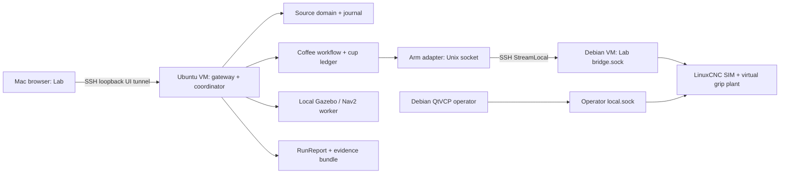

# BV01 Integration Completion & Native Simulation

Ngày: 06/11/2026. Trạng thái: **specified; implementation và acceptance chưa hoàn tất**. Đây là phần tiếp nối Plan 02/03, không thay thế các cổng hardware của [spec gốc](../2026-11-05-digital-twin/README.md).

- [Cơ sở nghiên cứu và baseline](../../research/2026-11-06-bv01-native-simulation.md)
- [Contracts, custody và evidence](contracts-and-evidence.md)
- [Verification và release gates](verification.md)
- [Implementation plans](../../plans/2026-11-06-bv01-native-simulation/README.md)

## 1. Outcome

Người dùng mở Lab, chọn BV01, nhấn Start Simulation, quan sát đơn cà phê từ đặt hàng đến xác nhận giao tại bàn. Mỗi chuyển tiếp có command correlation, chủ sở hữu cốc, deadline, fault có thể tái hiện và bằng chứng trong RunReport. Cùng workflow chạy mock trên Mac và native software simulation trên Linux; khác plant adapters, clocks và fidelity.

Không gọi bản mô phỏng là production-ready. Một controller thật trong VM vẫn đang điều khiển mô hình; grip/cup của SIM plant không phải cảm biến vật lý.

## 2. Phạm vi và yêu cầu

| ID | Yêu cầu bắt buộc | Tiêu chí quan sát được |
|---|---|---|
| BVI-01 | Khóa baseline, source/lab pin, môi trường và dependencies | Evidence khớp commit/artifact/schema thực chạy; dirty export bị từ chối |
| BVI-02 | Một coffee workflow dùng chung, domain là business authority | Mock và native cùng chuỗi domain decisions; không dùng UI hay adapter tự đánh dấu served |
| BVI-03 | Cup custody và physical attachment đúng một lần | Mỗi cup có tối đa một parent; duplicate/reordered/restart không nhân cốc, không gắp lại cốc đã lấy |
| BVI-04 | Gripper/cup observation đủ điều kiện xác nhận transfer | Command done không có grip/receiver evidence → attention/unknown, không confirm |
| BVI-05 | ARM03 và controller evidence đến RunReport/replay/inspector | Nhìn thấy command, coverage, epoch, reason và raw artifact; thiếu samples → not_run |
| BVI-06 | Readiness theo scenario và từng backend | Có nguyên nhân dependency/protocol/revision/staleness; UI không tự chạy lệnh tùy ý |
| BVI-07 | Fault schedule giới hạn và có checkpoint | Delay, disconnect, missing cup, gripper fault, blocker, restart có backend support rõ; mỗi fault một lần |
| BVI-08 | Offline R-MOCK đúng pin mới | Cold boot, network-off, import/export, rollback trên môi trường sạch; không yêu cầu checkout development |
| BVI-09 | UTM native profiles và standalone qualification | FD01 trước FD02/03/04/07; LinuxCNC smoke + GUI + arbitration/recovery; có raw logs |
| BVI-10 | Combined BV01 với clock/transport và admission đúng | Hai engine đang sống trong cùng run; barrier bounded; mất tunnel hoặc pause không sinh delivery giả |
| BVI-11 | Acceptance tách theo fidelity, target và evidence | Mock ≠ native; ARM64 VM ≠ amd64 release; blocked ≠ failed; owner quyết định accepted |
| BVI-12 | PostgreSQL, packaging, usability và signed release | Full PG suite; ≥5 người dùng mới; trust/installer/rollback trên target sạch; lưu blocker độc lập |

## 3. Kiến trúc được chọn

Trong mock mode mọi provider nằm trong runtime trên Mac. Trong native mode coordinator ở Ubuntu để giữ Gazebo subprocess và ROS dependency local. Browser truy cập một origin qua loopback SSH; không mở controller API trực tiếp ra LAN. Debian bridge vẫn phân biệt Lab/operator bằng socket ACL, không đổi owner kind theo payload client.

UTM reference: QEMU aarch64 + hypervisor, Ubuntu 24.04 ARM64, Debian 12 ARM64; mac-mock / linux-vm-sim / linux-amd64-sim là ba qualification profiles riêng. industrial-ipc nằm ngoài phạm vi triển khai này. Kết quả một VM chạy luân phiên chỉ qualify subsystem, không qualify combined.

## 4. Golden path và giới hạn hành vi

| Bước | Guard trước tác động | Bằng chứng để tiến bước | Timeout / lỗi |
|---|---|---|---|
| Order → brew | Recipe revision, nguyên liệu, cup tại nozzle, machine interlock | Coffee domain transitions + plant measurement | Out of stock/machine fault → held; không gọi arm |
| Brew → pick | Brew complete, cup có mặt, arm lease, model/world khớp | Program staged đúng hash, observed execution | Stage/start unknown → reconcile; không resend chuyển động |
| Pick → arm custody | Fresh grasp observation đúng cup/transfer/command/epoch | Closed + object present + bounded pose; takeCup một lần | Missing cup/grip/stale → attention, giữ uncertainty |
| Arm → AMR tray | AMR đúng mission/load stop/slot, stationary và dock ≤0,05 m | Giver released + receiver present, observer độc lập | AMR move/missing receiver → không confirm hoặc clear custody |
| AMR → table | CargoLoaded đã xác nhận và Cup transfer đúng | Nav arrival + người nhận/action đúng domain | Timeout/localization lost → attention; arrival không tự served |
| Complete | Delivery confirmed, cup owner tại table | Domain events + report assertions | Thiếu event bất kỳ → incomplete, không served-after-handoff pass |

Admission tách **pre-pick**, **post-grasp**, **pre-release**, **post-release**. Không yêu cầu gripper đã giữ cốc trước khi cho phép bắt đầu pick. Với release không rõ kết quả, physical state là unknown, không tự trả cốc về nozzle. Các deadline có duration/clock policy trong fixture; test không dùng sleep không giới hạn.

## 5. Quyết định tích hợp

1. `CoffeeDriver` được inject plant ports, giữ facade/default mock cho compatibility; native runner sử dụng cùng workflow/domain/dispatcher, không sao chép coffee state machine.
2. Physical cup ledger là projection có journal/checkpoint, tách khỏi domain custody. Apply observations idempotent trước, domain confirm theo evidence; crash recovery query/replay, không replay motion.
3. `start_job` có programRef được chuyển thành stage rồi start có journal riêng, liên kết cùng logical command. Không start nếu stage/hash/lease thất bại; không phát stage completion như logical job completion.
4. Virtual gripper chỉ ở SIM profile. Pin model transforms/tolerance và actual controller feedback; không suy grip từ completed event. Phần I/O phải qua allowlist có test từ chối ở mọi profile khác.
5. Thêm report extension; legacy report vẫn đọc được. Lưu producer provenance, engine và modeled aspects riêng; không thay toàn bộ evidence schema thành enum trạng thái mới.
6. Tunnel SSH được supervisor theo dõi, bridge socket local vẫn dùng adapter hiện tại. Remote principal chỉ thuộc Lab group; không có sudo/operator group. Reconnect cần hello/epoch/reconcile; không tự lấy lại motion ownership.
7. Hai VM không chia sẻ monotonic clock. Barriers dùng correlation và coordinator receive times; clock conversion chỉ khi có mapping và uncertainty đo được. Lease tiếp tục theo controller monotonic time khi Gazebo pause.

## 6. Global constraints

- Node 24.22.2; pnpm 10.32.1; dependencies khóa theo lockfile, không nâng major để hoàn thành task.
- Business authority/contracts/adapters ở `source/`; presentation/project UX ở `lab/`.
- Không sửa `trial/`, không chạm robot hoặc cổng `1880`/`1884`; UI/runtime loopback `4175`/`4176`.
- Mỗi run khóa mode, seed, backend versions, model/world/recipe/profile revisions và clock domains.
- UI Việt/Nhật/Anh; mọi nhãn kết quả phải nêu provenance và không nâng simulation thành hardware evidence.
- Native test thiếu môi trường ghi `not_run` với blocker; test đã chạy sai assertion ghi `fail`.
- Không export dirty source; không ghi secrets, VM disk, SSH private key hoặc signing key vào Git.
- Không xóa dữ liệu host để provision VM; storage và RAM preflight phải đạt trước khi tải image lớn.

## 7. Ngoài phạm vi hiện tại

Không fork simulator, viết lại QtVCP HMI, RL arm, fluid/thermal/force physics chi tiết, EtherCAT hoặc hardware motion. Calibration, STO/E-stop/safety relay/brake/timing/HIL/FAT/SAT của spec cũ vẫn bắt buộc trước hardware.

P1 sau R-MOCK golden path và native baseline: mở rộng layout editor hiện có thành restaurant setup; batch capacity 1/2/3 AMR và station count; sau đó ROI từ inputs minh bạch. ROI phải nêu currency/period, purchase/rental/maintenance/staff assumptions, queue horizon và uncertainty; dữ liệu simulation không là cam kết năng suất. P1 cần spec riêng từ dữ liệu sử dụng, không nằm trong ước lượng hai sprint này.
