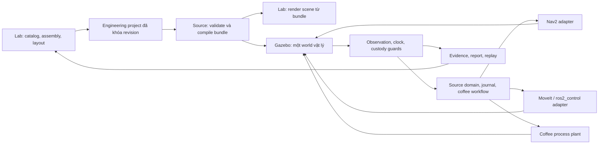

# Physical Robot Lab — robot giao món và trạm pha chế có tay máy

Ngày: 06/11/2026. Trạng thái: **spec đề xuất, chưa triển khai hoặc nghiệm thu**. Phạm vi đã được xác nhận: một robot giao món di động và một trạm pha chế cố định có tay máy. Bộ tài liệu này cụ thể hóa yêu cầu lắp ráp từ linh kiện thực và chạy mô phỏng có vật lý.

- [Linh kiện, assembly và hợp đồng dữ liệu](components-and-assembly.md)
- [Engine, điều khiển và chu trình pha chế](simulation-runtime.md)
- [Kiểm chứng, hiệu chuẩn và cổng nghiệm thu](verification.md)
- [Bảo toàn chức năng và ma trận hồi quy](compatibility.md)
- [Kế hoạch triển khai](../../plans/2026-11-06-physical-robot-lab/README.md)

## 1. Kết quả cần đạt

Người dùng chọn linh kiện có nguồn thông số, lắp thành robot/trạm, đặt chúng trong mặt bằng, kiểm tra kết nối và tải trọng, rồi chạy cùng thiết kế đó trong Gazebo. Robot nhận món/cốc, di chuyển đến bàn và trở về; tay máy lấy cốc tại máy pha, đặt lên khay robot. Đổi bán kính bánh, vị trí pin, tải khay hoặc vị trí trạm phải thay đổi đúng mô hình đang mô phỏng và làm mất hiệu lực bằng chứng cũ có liên quan.

Kết quả phải trả lời được: cấu hình có hợp lệ không; mô hình nào đã chạy; điều khiển và vật lý đã mô phỏng đến đâu; lỗi ở bước nào; thông số nào có nguồn hãng, thông số nào là giả định; cần đo gì trước khi dùng kết quả để chọn phần cứng.

MVP gồm một cấu hình AMR hai bánh chủ động tự lắp, một xArm 6 tham chiếu kèm gripper và má kẹp cốc, một máy pha mô hình quá trình, một loại cốc, một khay có vị trí đặt cốc, một mặt bằng và hai hành trình FD01/BV01. Khung, pin và truyền động chưa đủ dữ liệu hãng được phép tồn tại ở cấp mô hình giả định, nhưng không được mang nhãn đã hiệu chuẩn hoặc BOM sẵn sàng mua.

Đây là phần mở rộng của Lab hiện hữu. Giới hạn MVP chỉ áp dụng cho profile engineering mới; không thu hẹp Designer, S01, các scenario mock/mixed/hai AMR hoặc profile PUMA/LinuxCNC. Mọi chức năng hiện có phải giữ được hành trình sử dụng và dữ liệu theo [NR01–NR12](compatibility.md). Thiếu native runtime chỉ chặn chạy engineering; người dùng vẫn thiết kế, lưu/xuất dự án và dùng các profile cũ phù hợp.

## 2. Cơ sở code và khoảng trống

Baseline đọc: Lab `679a239`, source HEAD `d881c6f`; runtime thực được Lab pin là `f82b2057cae89b0029968212753df01f86f334ad`. Source HEAD và artifact đang chạy là hai danh tính khác nhau. Khi triển khai phải chụp lại baseline thực tế.

| Đang có | Khoảng trống cần xử lý | Điểm code chính, đường dẫn tính từ workspace |
|---|---|---|
| Designer, BOM, Three.js, layout, Twin workspace | Designer và Twin giữ project riêng; thiết kế chưa là đầu vào duy nhất của run | `lab/src/app.ts`, `lab/src/ui/workspace.ts` |
| Catalog minh họa, kiểm tra điện áp/payload | Thiếu SKU, từng link, inertia tensor, actuator/sensor model và nguồn từng tham số | `lab/src/design/catalog.ts`, `lab/fixtures/catalog/service-illustrative.json` |
| AssetRevision v2, primitives, mass tổng | Chưa có assembly graph đầy đủ, joint/connector graph hoặc readiness vật lý theo capability | `source/packages/contracts/schemas/asset-revision.schema.json` |
| Trình biên dịch Gazebo/URDF/Nav2 | Suy bánh xe từ box, dùng inertia giả định, drive lý tưởng | `source/robotics/simulation/compiler/compile_world.py` |
| Renderer robot và Twin | Bán kính bánh renderer = chiều cao drive × 0,75, compiler = chiều cao / 2; Twin arm hiện sơ đồ | `lab/src/viewer/robot.ts`, `lab/src/viewer/twin3d.ts` |
| Workflow coffee, journal, cup ledger, stage/start, replay | Phải giữ authority và thay plant; không viết lại workflow trong ROS/UI | `source/packages/lab-runtime/src/v2/beverage/`, `source/packages/lab-runtime/src/v2/scenarios/coffee.ts` |
| LinuxCNC/PUMA và virtual gripper | Feedback loopback/pose proximity không chứng minh lực kẹp hoặc tiếp xúc cốc | `source/integrations/arm-controller/configs/sim/puma560/machine.hal`, `bridge/sim_gripper.py` trong cùng integration |
| Coffee I/O simulator | Quá trình mock, không phải mô hình lưu lượng/nhiệt đã hiệu chuẩn | `source/packages/cell-adapters/src/coffee-io-sim.ts` |

Vòng rà soát trước khi viết spec: Lab có 188 test pass, 1 skip; typecheck, build và check:source pass trên Node 24.22.2. Đây là baseline phần mềm hiện hữu, không phải test của feature mới. Native doctor trên host macOS trả exit 2 do thiếu môi trường ROS/Gazebo phù hợp. Chưa có kết quả chạy vật lý mới. [Evidence BV01 hiện có](../../implementation/evidence/bv01-native-simulation/README.md) vẫn giữ nguyên phạm vi của nó.

## 3. Lựa chọn kiến trúc

| Phương án | Đánh giá |
|---|---|
| Mở rộng Three.js thành engine vật lý chính | Dễ demo nhưng phải tự xây nhiều phần robotics/controller/sensor; không chọn |
| Gazebo/Nav2 và LinuxCNC/PUMA làm đường duy nhất | Tái dùng controller hiện hữu nhưng khó ánh xạ chính xác arm thương mại và đồng bộ tiếp xúc giữa hai engine |
| **Gazebo + Nav2 + MoveIt 2 + ros2_control trong một world** | Chọn cho profile lắp ráp vật lý mới; giữ source workflow, Lab UI và legacy profiles |

Gazebo quản lý động lực học, tiếp xúc, sensor và thời gian mô phỏng. Nav2 điều hướng AMR; MoveIt 2 lập kế hoạch tay máy; ros2_control đưa lệnh khớp vào mô hình Gazebo. Một world chứa AMR, arm, gripper, cốc, máy pha và fixtures. Chạy đầu tiên trên Ubuntu 24.04/ROS Jazzy/Gazebo Harmonic; ARM64 VM và Linux amd64 cần qualification riêng. [Tài liệu gz_ros2_control Jazzy](https://control.ros.org/jazzy/doc/gz_ros2_control/doc/index.html) xác nhận tích hợp controller manager với Gazebo và cặp Harmonic.

Profile PUMA/LinuxCNC cũ vẫn dùng cho kiểm tra controller và hồi quy. Bộ spec này thay lựa chọn engine cho **profile vật lý thương mại mới**, không thay đổi kết quả hoặc các cổng nghiệm thu của [digital twin cũ](../2026-11-05-digital-twin/README.md) và [BV01 native](../2026-11-06-bv01-native-simulation/README.md). Không đòi Debian/LinuxCNC VM để chạy profile mới.

## 4. Yêu cầu có thể truy vết

| ID | Yêu cầu | Điều kiện đạt |
|---|---|---|
| PHY-01 | Một engineering project cho thiết kế → chạy → báo cáo | Hash assembly/scene trùng giữa viewer, compiler và run; sửa thiết kế không sửa run đang chạy |
| PHY-02 | Catalog linh kiện có provenance và revision | Mỗi tham số vật lý có nguồn/giả định; exact SKU hoặc trạng thái candidate rõ; BOM có thiếu dữ liệu |
| PHY-03 | Lắp ráp cơ khí, điện và dữ liệu có kiểm tra | Chặn cycle, joint/port sai, sai điện áp, tải vượt, mesh/parameter thiếu theo capability |
| PHY-04 | Biên dịch model nhất quán | URDF/SDF/scene/frames/BOM dùng chung resolved assembly; không suy bánh từ kích thước vỏ |
| PHY-05 | Điều hướng có vật lý và sensor | FD01 dùng Nav2, contact/sensor/odom mô phỏng; ghi torque/control fidelity và collision evidence |
| PHY-06 | Tay máy thương mại + tool trong cùng world | Joint limits, self/world collision, FK/IK và execution feedback; dùng đúng revision vendor/tool |
| PHY-07 | Gắp/đặt cốc có quan sát vật lý | Không teleport/parent theo workflow; custody chỉ đổi sau quan sát độc lập đủ điều kiện |
| PHY-08 | Pha chế có process model minh bạch | Lưu lượng/khối lượng/tồn kho/deadline nhất quán, có fault; chưa hiệu chuẩn hiển thị modeled |
| PHY-09 | Cùng workflow, đúng authority và recovery | Mock/legacy/new profile không tự xác nhận served; restart không replay motion |
| PHY-10 | Clock, identity và evidence đủ kiểm chứng | Mỗi run pin inputs; loss/staleness có blocker; replay không phát command |
| PHY-11 | Lab sử dụng được toàn hành trình | Catalog → assembly → layout → preflight → run → report; Việt/Nhật/Anh, giữ 2D fallback |
| PHY-12 | Qualification và calibration tách biệt | Portable/native/calibrated/hardware không suy diễn lẫn nhau; tất cả gate có evidence hoặc blocker |
| PHY-13 | Nâng cấp bổ sung, không mất chức năng/dữ liệu hiện hữu | NR01–NR12 có task/test/evidence; giữ legacy APIs, lưu/xuất/undo/redo, mọi scenario cũ và browser journeys; không đổi pass cũ thành skip để phát hành |

## 5. Mức độ mô phỏng

Không dùng một boolean `dynamics` để gắn chất lượng cho toàn bộ robot. Mỗi report có vector capabilities: geometry, rigidBody, actuator, sensor, grasp, process, calibration; từng mục lưu `unsupported | modeled | verified` và evidence refs.

| Gate | Được phép kết luận | Chưa được phép kết luận |
|---|---|---|
| G0 — hợp đồng và assembly | Thiết kế nhất quán, biên dịch tái lập | Đã chạy engine |
| G1 — native rigid body | Các case vật lý đã chạy và đạt trong model cụ thể | Lực/motor/thời gian thực tế chính xác |
| G2 — contact manipulation | Cốc được gắp/đặt bằng tiếp xúc trong model; workflow hoàn chỉnh | Má kẹp thật đủ lực, cốc thật không biến dạng |
| G3 — calibration | Những đại lượng đã đo đạt sai số đã định nghĩa | Những đại lượng chưa đo hoặc ngoài miền đã đo |
| Hardware acceptance | Nằm ngoài đợt triển khai này | Không được tự nhận từ G0–G3 |

## 6. Global Constraints

- Node 24.22.2; pnpm 10.32.1; dependencies khóa theo lockfile, không nâng major để hoàn thành task.
- Business authority/contracts/adapters ở `source/`; presentation/project UX ở `lab/`.
- Không sửa `trial/`, không chạm robot hoặc cổng `1880`/`1884`; UI/runtime loopback `4175`/`4176`.
- Mỗi run khóa mode, seed, backend versions, model/world/recipe/profile revisions và clock domains.
- UI Việt/Nhật/Anh; mọi nhãn kết quả phải nêu provenance và không nâng simulation thành hardware evidence.
- Native test thiếu môi trường ghi `not_run` với blocker; test đã chạy sai assertion ghi `fail`.
- Không export dirty source; không ghi secrets, VM disk, SSH private key hoặc signing key vào Git.
- Không xóa dữ liệu host để provision VM; storage và RAM preflight phải đạt trước khi tải image lớn.
- Engineering profile không tự fallback sang mock, legacy hoặc hardware khi thiếu capability.
- Giữ toàn bộ chức năng và dữ liệu hiện hữu theo NR01–NR12; giới hạn MVP engineering không áp dụng cho các profile cũ.

## 7. Giới hạn và quyết định đã chốt

Không làm mobile manipulator, bếp nấu, mô phỏng chất lỏng CFD, đào tạo RL, marketplace import CAD tùy ý, hoặc triển khai điều khiển robot thật. MVP dùng cốc được đặt sẵn ở vị trí nozzle; cấp cốc tự động là feature riêng. Brew là process model; chất lỏng được quy đổi thành khối lượng/inertia có cập nhật, chưa mô phỏng sóng nước và bắn tràn.

Đã chọn xArm 6 làm reference model đầu tiên, không phải quyết định mua. Truyền động/pin/má kẹp/máy pha cần dữ liệu để khóa exact configuration; [sổ quyết định linh kiện](components-and-assembly.md#6-sổ-quyết-định-linh-kiện) quy định ai/công việc nào giải quyết và gate bị chặn. Không lấy giá catalog minh họa làm ngân sách mua sắm. Lịch triển khai đi theo gate; chỉ ước lượng lịch sau native spike và inventory thực tế.
